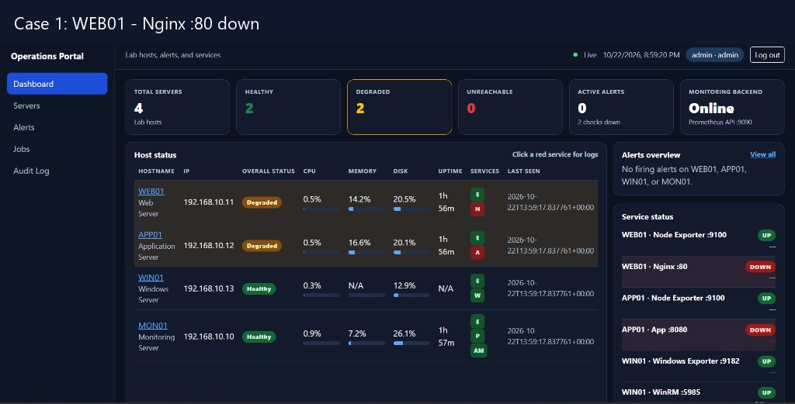
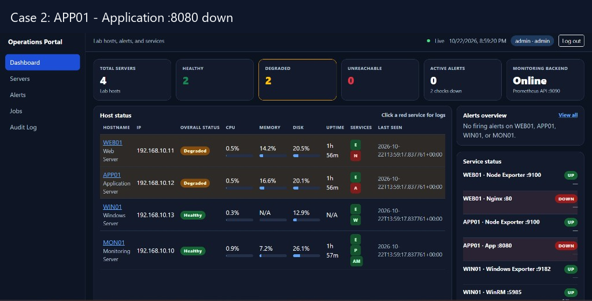
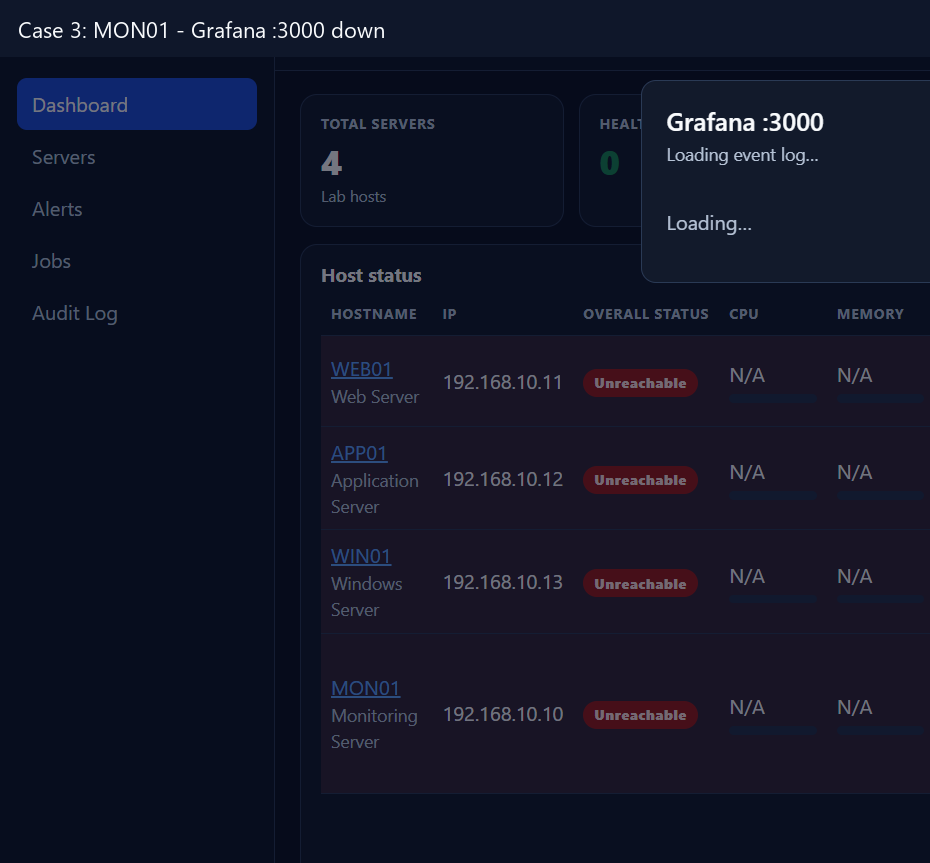
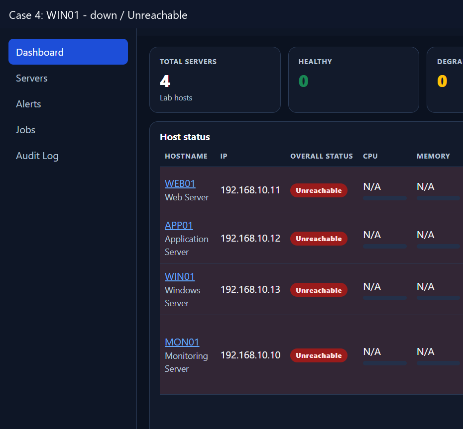

# Báo cáo Tuần 3

Nguyễn Thế Gia Bảo – Application / Integration

Khai báo AI: [khai-bao-ai.md](khai-bao-ai.md)

## Công việc được phân công

- Chuẩn bị tích hợp Web Portal với Prometheus API: cấu hình endpoint, timeout, token (nếu có) và kiểm tra portal vẫn chạy khi Prometheus chưa sẵn sàng hoặc mất kết nối.
- Xây dựng service layer lấy dữ liệu monitoring: PromQL instant query, health check, ánh xạ instance lab (WEB01, APP01, WIN01, MON01) sang inventory SQLite.
- Hiển thị trạng thái server và metrics thật trên Dashboard: CPU, RAM, Disk, Uptime, exporter UP/DOWN và probe HTTP/TCP của dịch vụ trên từng host.
- Chuẩn bị cấu trúc tích hợp Ansible: giữ mock executor mặc định; giữ playbook allow-list, `automation_group` theo host và adapter `AnsibleRunnerExecutor` chưa spawn process lên máy thật.
- Hoàn thiện xử lý lỗi và giao diện các module hiện tại: fail-closed N/A, Monitoring Backend Down, RBAC giữ nguyên, Alerts/Jobs/Audit vẫn mở khi monitoring chết.

## Kết quả thực hiện

1. Hoàn thành tích hợp Prometheus API. Portal trên laptop gọi `http://192.168.10.10:9090` (đường đi laptop → Tailscale → MGMT01 → MON01). `PrometheusClient` bọc instant query, range query, list alerts và `/-/healthy`; timeout mặc định 3 giây; token không bị lộ trong thông báo lỗi. Biến cấu hình: `PROMETHEUS_BASE_URL`, `PROMETHEUS_TIMEOUT_SECONDS`.
2. Hoàn thành service layer monitoring. `app/services/prometheus.py` gọi API; `app/services/metrics.py` gom PromQL theo host Linux (`node_*`) và Windows (`windows_*`); `app/services/inventory.py` map `192.168.10.11:9100` → WEB01, `192.168.10.12:9100` → APP01, `192.168.10.13:9182` → WIN01, `192.168.10.10:9100` → MON01. Metric host MON01 lấy từ Node Exporter `:9100`, không nhầm với Prometheus `:9090`. `:9090` chỉ dùng làm Monitoring Backend / service health.
3. Hoàn thành Dashboard live. Bốn nhóm thông tin: (1) Host status Healthy / Degraded / Unreachable; (2) CPU, Memory, Disk, Uptime; (3) exporter UP/DOWN; (4) probe dịch vụ — WEB01 Nginx `:80`, APP01 App `:8080`, WIN01 WinRM `:5985`, MON01 Prometheus `:9090`, Alertmanager `:9093`, Grafana `:3000`. Trang poll JSON `/dashboard/snapshot` khoảng 5 giây. Bấm service DOWN mở event log (`/dashboard/events/<host>`) gồm probe, alert, audit và job liên quan.
4. Hoàn thành xử lý lỗi fail-closed. Khi Prometheus/MON01 không trả lời: dashboard HTTP 200, metrics N/A, Monitoring Backend Down/Unavailable, host Unreachable; Inventory, Alerts, Jobs, Audit vẫn mở. pytest phủ timeout, malformed payload, webhook và mapping instance.
5. Chuẩn bị cấu trúc Ansible, chưa chạy playbook lên lab. Executor mặc định vẫn là mock. `AnsibleRunnerExecutor` trả về thất bại có kiểm soát (“Real Ansible execution is disabled in MVP”). Allow-list: `restart_service`, `restart_container`, `disk_cleanup` tương ứng `automation/ansible/playbooks/*.yml`. Server lab có `automation_group` `linux_web` / `linux_app` / `windows_app` / `linux_mon`. `AUTO_REMEDIATION_ENABLED=false`.
6. Bổ sung Alertmanager webhook `POST /api/alerts/webhook` (CSRF exempt). Payload map instance `192.168.10.11:9100` → WEB01, lưu SQLite, chống trùng fingerprint, cập nhật firing → resolved không tạo bản ghi mới. Audit: `alert.received`, `alert.resolved`, `prometheus.unavailable`. Có script `scripts/send-test-webhook.ps1` và mẫu receiver `configs/alertmanager-webhook.yml`.
7. Làm mới giao diện Operations Portal (dark, contrast cao): KPI Total/Healthy/Degraded/Unreachable, Alerts overview, Service status, thanh CPU/RAM/Disk. Seed lab đúng bốn máy WEB01, APP01, WIN01, MON01. Tài liệu tuần 3 theo cây `application/docs/week03/` (setup, configs, scripts, tests, screenshots).
8. Chụp evidence bốn test case trên lab: WEB01 Nginx down (host Degraded, exporter UP, Nginx `:80` DOWN); APP01 container down (App `:8080` DOWN); MON01 Grafana `:3000` down; WIN01 Unreachable (`:9182` và WinRM `:5985` không kết nối).

## Kết quả trên GitHub

Trạng thái: Hoàn thành nội dung Tuần 3. Code và evidence nằm trên nhánh `application`, đã merge thư mục `application/` vào `main`. Không đẩy phần Application lên nhánh `infra`.

| Kết quả | Commit message | Link | Commit |
| --- | --- | --- | --- |
| Nhánh Application | Add live lab monitoring, Alertmanager webhook, and host health dashboard. | [application/](https://github.com/Cucbong30/cloud-infrastructure-monitoring-automation/tree/application/application) | [6f6fda8](https://github.com/Cucbong30/cloud-infrastructure-monitoring-automation/commit/6f6fda8a47b0b9d7ad2bde4db8cb0269f9e3de6b) |
| Prometheus client | add Prometheus API client and fail-closed health | [prometheus.py](https://github.com/Cucbong30/cloud-infrastructure-monitoring-automation/blob/6f6fda8a47b0b9d7ad2bde4db8cb0269f9e3de6b/application/app/services/prometheus.py) | cùng commit |
| Service layer metrics | add PromQL host metrics, exporter and HTTP/TCP probes | [metrics.py](https://github.com/Cucbong30/cloud-infrastructure-monitoring-automation/blob/6f6fda8a47b0b9d7ad2bde4db8cb0269f9e3de6b/application/app/services/metrics.py) | [probes.py](https://github.com/Cucbong30/cloud-infrastructure-monitoring-automation/blob/6f6fda8a47b0b9d7ad2bde4db8cb0269f9e3de6b/application/app/services/probes.py) |
| Lab inventory mapping | map WEB01/APP01/WIN01/MON01 monitoring targets | [inventory.py](https://github.com/Cucbong30/cloud-infrastructure-monitoring-automation/blob/6f6fda8a47b0b9d7ad2bde4db8cb0269f9e3de6b/application/app/services/inventory.py) | cùng commit |
| Dashboard live | add live dashboard snapshot, host health and event log | [dashboard.py](https://github.com/Cucbong30/cloud-infrastructure-monitoring-automation/blob/6f6fda8a47b0b9d7ad2bde4db8cb0269f9e3de6b/application/app/blueprints/dashboard.py) | [dashboard.html](https://github.com/Cucbong30/cloud-infrastructure-monitoring-automation/blob/6f6fda8a47b0b9d7ad2bde4db8cb0269f9e3de6b/application/app/templates/dashboard.html) |
| Alertmanager webhook | add Alertmanager webhook ingest and fingerprint dedupe | [webhooks.py](https://github.com/Cucbong30/cloud-infrastructure-monitoring-automation/blob/6f6fda8a47b0b9d7ad2bde4db8cb0269f9e3de6b/application/app/blueprints/webhooks.py) | [alert_webhook.py](https://github.com/Cucbong30/cloud-infrastructure-monitoring-automation/blob/6f6fda8a47b0b9d7ad2bde4db8cb0269f9e3de6b/application/app/services/alert_webhook.py) |
| Ansible adapter | keep mock default; Ansible executor and allow-listed playbooks | [ansible.py](https://github.com/Cucbong30/cloud-infrastructure-monitoring-automation/blob/6f6fda8a47b0b9d7ad2bde4db8cb0269f9e3de6b/application/app/executors/ansible.py) | [playbooks](https://github.com/Cucbong30/cloud-infrastructure-monitoring-automation/tree/6f6fda8a47b0b9d7ad2bde4db8cb0269f9e3de6b/application/automation/ansible/playbooks) |
| Tests tuần 3 | add Prometheus, probe, webhook and inventory tests | [tests](https://github.com/Cucbong30/cloud-infrastructure-monitoring-automation/tree/6f6fda8a47b0b9d7ad2bde4db8cb0269f9e3de6b/application/tests) | [test_prometheus.py](https://github.com/Cucbong30/cloud-infrastructure-monitoring-automation/blob/6f6fda8a47b0b9d7ad2bde4db8cb0269f9e3de6b/application/tests/test_prometheus.py) |
| Docs week03 | add application/docs/week03 setup, configs, scripts, tests | [docs/week03](https://github.com/Cucbong30/cloud-infrastructure-monitoring-automation/tree/application/application/docs/week03) | cùng nhánh |
| Ảnh WEB01 Nginx down | add week 3 dashboard evidence for Nginx down | [01-web01-nginx-down.png](https://github.com/Cucbong30/cloud-infrastructure-monitoring-automation/blob/ed3ee4fa739ff12ebd863765c08aa41d30bfc7aa/application/docs/week03/screenshots/01-web01-nginx-down.png) | [ed3ee4f](https://github.com/Cucbong30/cloud-infrastructure-monitoring-automation/commit/ed3ee4fa739ff12ebd863765c08aa41d30bfc7aa) |
| Ảnh APP01 container down | add week 3 dashboard evidence for App :8080 down | [02-app01-container-down.png](https://github.com/Cucbong30/cloud-infrastructure-monitoring-automation/blob/ed3ee4fa739ff12ebd863765c08aa41d30bfc7aa/application/docs/week03/screenshots/02-app01-container-down.png) | [ed3ee4f](https://github.com/Cucbong30/cloud-infrastructure-monitoring-automation/commit/ed3ee4fa739ff12ebd863765c08aa41d30bfc7aa) |
| Ảnh MON01 Grafana down | add week 3 dashboard evidence for Grafana :3000 down | [03-mon01-grafana-down.png](https://github.com/Cucbong30/cloud-infrastructure-monitoring-automation/blob/ed3ee4fa739ff12ebd863765c08aa41d30bfc7aa/application/docs/week03/screenshots/03-mon01-grafana-down.png) | [ed3ee4f](https://github.com/Cucbong30/cloud-infrastructure-monitoring-automation/commit/ed3ee4fa739ff12ebd863765c08aa41d30bfc7aa) |
| Ảnh WIN01 down | add week 3 dashboard evidence for WIN01 Unreachable | [04-win01-down.png](https://github.com/Cucbong30/cloud-infrastructure-monitoring-automation/blob/ed3ee4fa739ff12ebd863765c08aa41d30bfc7aa/application/docs/week03/screenshots/04-win01-down.png) | [ed3ee4f](https://github.com/Cucbong30/cloud-infrastructure-monitoring-automation/commit/ed3ee4fa739ff12ebd863765c08aa41d30bfc7aa) |
| Merge vào main | Merge week 3 portal updates and test-case screenshots into application on main. | [main/application](https://github.com/Cucbong30/cloud-infrastructure-monitoring-automation/tree/main/application) | [1917297](https://github.com/Cucbong30/cloud-infrastructure-monitoring-automation/commit/191729749fafc36533490adae0f2c8228439b5d6) |

## Minh chứng giao diện đã chạy

Các ảnh dưới đây được chụp từ Operations Portal khi portal chạy trên laptop. Ảnh nguồn: [screenshots](screenshots/).

Hình 1. WEB01 – Nginx down: host Degraded, Node Exporter UP, Nginx `:80` DOWN.

Hình 2. APP01 – Application container down: host Degraded, exporter UP, App `:8080` DOWN.

Hình 3. MON01 – Grafana `:3000` down; host Unreachable khi backend/probe không trả lời.

Hình 4. WIN01 – down/Unreachable; CPU/Memory/Disk N/A, exporter `:9182` không kết nối.

## Luồng sự cố đã kiểm tra

1. Service HTTP chết, exporter còn sống: tắt Nginx trên WEB01 hoặc container trên APP01 → Dashboard Degraded, đúng hàng service DOWN, metric CPU/RAM/Disk vẫn có vì `:9100` còn up.
2. Grafana chết: probe `http://192.168.10.10:3000/` thất bại → Grafana DOWN; nếu cả Prometheus API cũng không trả lời thì Monitoring Backend Down và MON01 Unreachable.
3. WIN01 down: ping/`:9182`/`:5985` timeout → Unreachable, N/A. Alertmanager trên MON01 không gửi được webhook nếu chính MON01 chết; portal vẫn phát hiện bằng probe, không phụ thuộc webhook.
4. WEB01 exporter down (luồng tuần 3 với Alertmanager): Prometheus InstanceDown → Alertmanager → `POST /api/alerts/webhook` → SQLite → Alerts UI; khi lên lại cùng fingerprint chuyển resolved.
