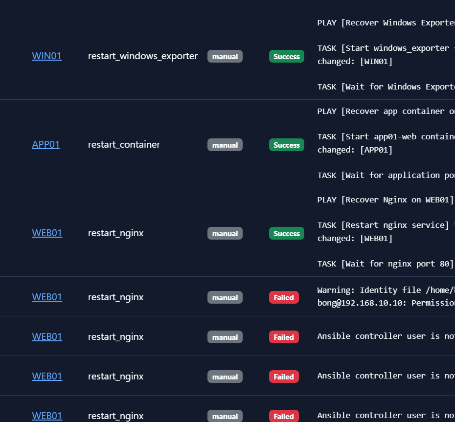
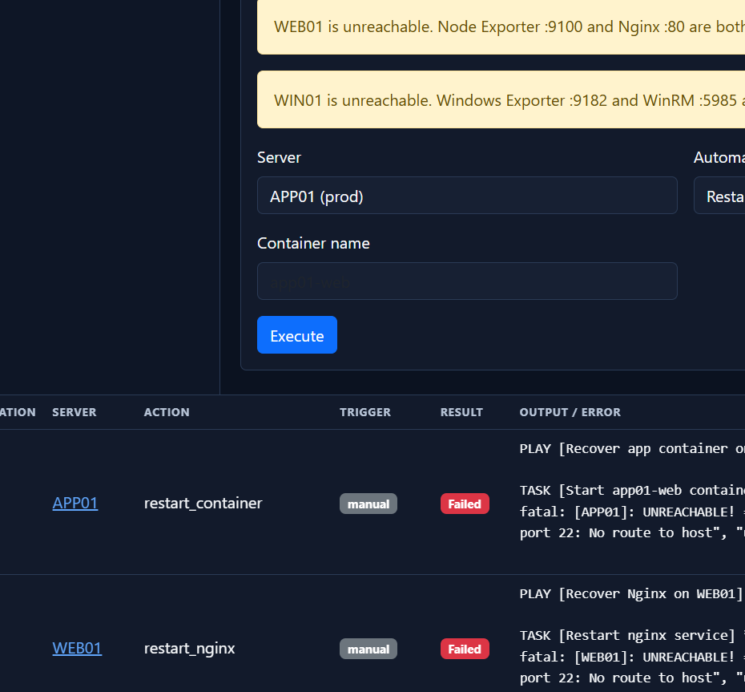
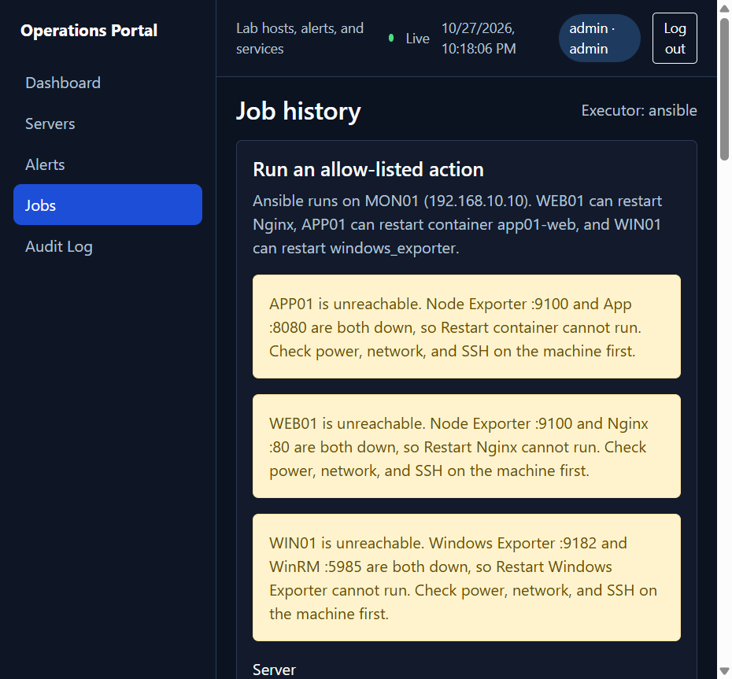
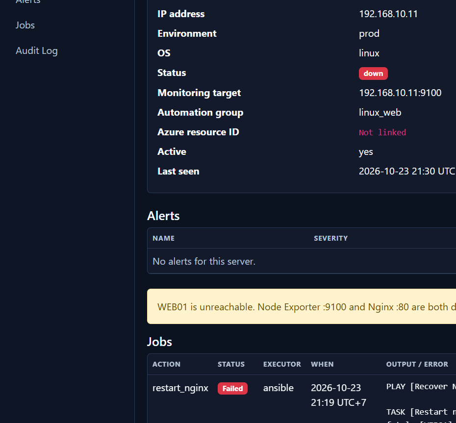
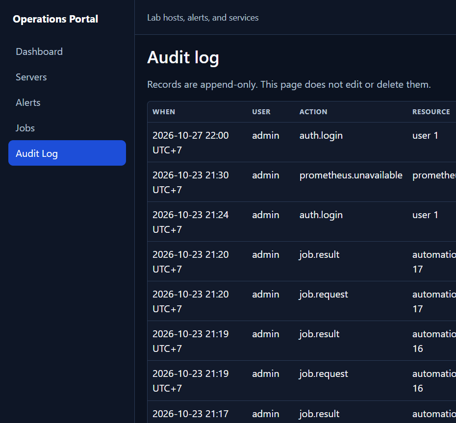

# Báo cáo Tuần 4

Nguyễn Thế Gia Bảo – Application / Integration

Khai báo AI: [ai-usage.md](ai-usage.md)

## Công việc được phân công

- Kết nối Portal với Ansible execution.
- Hoàn thiện Jobs module.
- Lưu execution history.
- Hiển thị automation result.
- Kết nối alert với remediation action.
- Hoàn thiện Audit Log cho automation.

## Kết quả thực hiện

Em bỏ mock làm đường chạy lab. `AUTOMATION_EXECUTOR=ansible`. Portal trên laptop SSH sang MON01 `192.168.10.10`, user `bong`, rồi gọi đúng một lệnh `ansible-playbook` với đường dẫn cố định. Form không được gửi path, lệnh shell, hay tên playbook. Ba action còn lại trong allow-list:

| Action | Máy | IP | Playbook trên MON01 | Kết quả mong đợi |
| --- | --- | --- | --- | --- |
| `restart_nginx` | WEB01 | 192.168.10.11 | `~/ansible/playbooks/restart-nginx.yml` | Nginx `:80` UP |
| `restart_container` | APP01 | 192.168.10.12 | `~/ansible/playbooks/restart-app-container.yml` | container `app01-web`, App `:8080` UP |
| `restart_windows_exporter` | WIN01 | 192.168.10.13 | `~/ansible/playbooks/restart-windows-exporter.yml` | service `windows_exporter`, `:9182` UP |

`restart_service` và `disk_cleanup` em gỡ khỏi allow-list. Sai máy với sai action thì job không chạy. Container và service name lấy từ map này (`app01-web`, `windows_exporter`), không lấy từ ô gõ tự do.

Trang Jobs có chọn Server, chọn Automation action, rồi Execute. Trạng thái trong database vẫn là `queued`, `running`, `succeeded`, `failed`. Trên giao diện em đổi nhãn thành Pending, Running, Success, Failed. Mỗi job lưu giờ bắt đầu, giờ kết thúc, thời lượng, server, action, trigger, exit code và output/error. Giờ hiển thị UTC+7.

Audit cho automation là `job.request` lúc tạo job và `job.result` lúc xong. Trang Audit Log chỉ thêm dòng, không sửa và không xóa. `AUTO_REMEDIATION_ENABLED` vẫn là `false`, nên portal không tự chạy playbook khi có alert. Operator hoặc admin bấm remediation từ Server Detail hoặc từ Alert khi máy còn tới được. Ba job Success bên dưới em bấm Execute trên trang Jobs, trigger là `manual`.

Em thử lúc chưa điền user SSH. Ba job `restart_nginx` trên WEB01 Failed ngay, output là `Ansible controller user is not configured.` Portal không crash. Sau khi điền user `bong` nhưng key trỏ vào `/home/bong/.ssh/id_ed25519` (đường dẫn trên MON01, không có file này trên laptop), một job Failed exit 255: `Permission denied (publickey,password)`.

Tối 23/10/2026 SSH vẫn cảnh báo không mở được file key đó, nhưng MON01 vẫn chạy playbook và ba flow trả HTTP 200:

- 21:08 UTC+7, WEB01, `restart_nginx`, 4 giây, Success. Play `Recover Nginx on WEB01`: restart nginx `changed`, chờ cổng 80 `ok`, HTTP 200. Recap `ok=4 changed=1 unreachable=0 failed=0`.
- 21:14 UTC+7, APP01, `restart_container`, 4 giây, Success. Container `app01-web` `changed`, chờ cổng 8080 `ok`, HTTP 200.
- 21:16 UTC+7, WIN01, `restart_windows_exporter`, 7 giây, Success. Service `windows_exporter` `changed`, chờ cổng 9182 `ok`, HTTP 200.

Sau đó máy không còn route. 21:19 WEB01 `restart_nginx` Failed exit 4: `ssh: connect to host 192.168.10.11 port 22: No route to host`. 21:20 APP01 `restart_container` Failed cùng kiểu với `192.168.10.12`. Output nằm trên job, audit có `job.request` và `job.result`, trang Jobs vẫn mở.

Khi exporter và dịch vụ cùng DOWN, máy là Unreachable. Lúc đó restart không tới được host, nên em không hiện nút Restart Nginx, Restart container hay Restart Windows Exporter. Portal hiện một thông báo, ví dụ WEB01: exporter `:9100` và Nginx `:80` cùng tắt, Restart Nginx không chạy, cần kiểm tra nguồn, mạng và SSH trước. APP01 và WIN01 dùng cùng một câu với App `:8080` và Windows Exporter `:9182`. Bấm Execute khi máy đang `down` cũng không tạo job mới.

## Kết quả trên GitHub

Trạng thái: module Jobs đã nối Ansible allow-list và đã chạy ba playbook trên lab. Code và evidence nằm trên nhánh `application`. Mỗi file chỉ để một link.

| Kết quả | Commit message | Link | Commit |
| --- | --- | --- | --- |
| Jobs nối Ansible | Connect portal jobs to the MON01 Ansible allow-list. | [application/](https://github.com/Cucbong30/cloud-infrastructure-monitoring-automation/tree/aecb279c07407ae612b4b9476fec702ddeaa1eaf/application) | [aecb279](https://github.com/Cucbong30/cloud-infrastructure-monitoring-automation/commit/aecb279c07407ae612b4b9476fec702ddeaa1eaf) |
| SSH sang MON01 | run one allow-listed playbook on 192.168.10.10 | [ansible.py](https://github.com/Cucbong30/cloud-infrastructure-monitoring-automation/blob/aecb279c07407ae612b4b9476fec702ddeaa1eaf/application/app/executors/ansible.py) | cùng commit |
| Allow-list 3 action | map restart_nginx, restart_container, restart_windows_exporter | [actions.py](https://github.com/Cucbong30/cloud-infrastructure-monitoring-automation/blob/aecb279c07407ae612b4b9476fec702ddeaa1eaf/application/app/executors/actions.py) | cùng commit |
| Job history | store time, server, action, result, output and audit | [automation.py](https://github.com/Cucbong30/cloud-infrastructure-monitoring-automation/blob/aecb279c07407ae612b4b9476fec702ddeaa1eaf/application/app/services/automation.py) | cùng commit |
| Nhãn Pending/Running/Success/Failed | map queued, running, succeeded, failed | [presentation.py](https://github.com/Cucbong30/cloud-infrastructure-monitoring-automation/blob/aecb279c07407ae612b4b9476fec702ddeaa1eaf/application/app/presentation.py) | cùng commit |
| Trang Jobs | Server, action, Execute, history | [list.html](https://github.com/Cucbong30/cloud-infrastructure-monitoring-automation/blob/aecb279c07407ae612b4b9476fec702ddeaa1eaf/application/app/templates/automation/list.html) | cùng commit |
| Remediation từ Alert và Server | suggest the one allow-listed action, or a notice when the host is down | [remediation.py](https://github.com/Cucbong30/cloud-infrastructure-monitoring-automation/blob/aecb279c07407ae612b4b9476fec702ddeaa1eaf/application/app/services/remediation.py) | cùng commit |
| Playbook path | three fixed paths, old restart_service and disk_cleanup removed | [playbooks](https://github.com/Cucbong30/cloud-infrastructure-monitoring-automation/tree/aecb279c07407ae612b4b9476fec702ddeaa1eaf/application/automation/ansible/playbooks) | cùng commit |
| Tests | allow-list, job result, unreachable notice | [test_automation.py](https://github.com/Cucbong30/cloud-infrastructure-monitoring-automation/blob/aecb279c07407ae612b4b9476fec702ddeaa1eaf/application/tests/test_automation.py) | cùng commit |
| Ảnh ba playbook Success | WIN01, APP01, WEB01 Success and the earlier Failed rows | [02-three-playbooks-success.png](screenshots/02-three-playbooks-success.png) | [64b6de0](https://github.com/Cucbong30/cloud-infrastructure-monitoring-automation/commit/64b6de060eb31a7b09230cf36afa0e88b6673969) |
| Ảnh target Unreachable | Failed, No route to host, portal still shows the job | [03-playbook-unreachable-failed.png](screenshots/03-playbook-unreachable-failed.png) | cùng commit ảnh |
| Ảnh không còn nút restart | three unreachable notices on the Jobs page | [01-unreachable-instead-of-restart.png](screenshots/01-unreachable-instead-of-restart.png) | cùng commit ảnh |
| Ảnh Server Detail | WEB01 down, one notice, no Restart Nginx button | [04-web01-server-detail.png](screenshots/04-web01-server-detail.png) | cùng commit ảnh |
| Ảnh Audit Log | job.request and job.result for the automation jobs | [05-audit-job-events.png](screenshots/05-audit-job-events.png) | cùng commit ảnh |

## Luồng đã kiểm tra

- WEB01 Nginx: Execute `restart_nginx`. MON01 chạy `restart-nginx.yml`. Job Success, output có HTTP 200 trên cổng 80.
- APP01 container: Execute `restart_container`. Container `app01-web` changed. Job Success, output có HTTP 200 trên cổng 8080.
- WIN01 Windows Exporter: Execute `restart_windows_exporter`. Service changed. Job Success, output có HTTP 200 trên cổng 9182.
- Ansible hoặc target lỗi: user trống, key không mở được, hoặc `No route to host`. Job Failed, output và exit code được lưu, audit có `job.result`, portal không crash.
- Cả exporter và dịch vụ DOWN: không hiện nút restart. Một thông báo Unreachable cho WEB01, APP01 và WIN01.

## Ảnh test case

