# Báo cáo Tuần 8

Nguyễn Thế Gia Bảo – Application / Integration

## Công việc được phân công

- Admin và Operator được chạy Manual Remediation. Viewer không có nút, và backend trả 403.
- Job MANUAL ghi actor, role, mode, target, action, timestamp, result và final status.
- Job AUTO ghi actor SYSTEM, mode AUTO.
- Trùng target và action khi đã có job queued hoặc running thì job mới là DUPLICATE_SKIPPED, playbook không chạy.
- Execution failed gửi mail Critical. Retry đúng một lần thì gửi mail Warning. SSH down thì MANAGEMENT_BLOCKED, playbook không chạy, mail Blocked gửi nhóm Warning.
- AZURE01 không nhận private key từ portal. Portal gọi `restart-azure-nginx.yml`. Ansible lấy SSH key từ `/etc/ansible/hosts` trên MON01.
- Manual run không tự retry. Verification failed và kênh quản trị down cũng không dùng ngân sách retry.

## Kết quả thực hiện

Tuần này em giữ policy tuần 6 và mail tuần 7. Phần mới là RBAC cho nút chạy tay, audit ghi đúng người bấm, chặn job trùng bằng trạng thái DUPLICATE_SKIPPED, và bỏ private key của AZURE01 ra khỏi lệnh portal. Portal SSH vào MON01 `192.168.10.10` rồi chạy `ansible-playbook -i /etc/ansible/hosts`. File key tới MON01 chỉ được thêm vào lệnh SSH khi file đó có thật trên máy portal. Key `azure01_ed25519` nằm trong inventory trên MON01, không nằm trong repo và không được portal gửi lên.

Giờ dưới đây là giờ portal, đã cộng bảy tiếng so với giờ lưu trong SQLite. Lab chạy tối 13/11 trên `http://localhost:5000`.

### RBAC

21:10, em đăng nhập `ntgbao@cucbong.id.vn`, role admin. Dashboard có menu Users. WEB01 `192.168.10.11` Healthy, SSH UP.

21:13, job 64, WEB01, `restart_nginx`, mode MANUAL, trigger Manual, actor `ntgbao@cucbong.id.vn`, role admin, attempt 1, exit code 0, verification passed, final SUCCESS. Incident 39 đóng vì success. Retry count 0.

21:18, em đăng nhập `cucbong-itservice@cucbong.id.vn`, role viewer. Menu không còn Users và không còn Audit Log. 21:19, trang Jobs ghi Manual remediation is not available for this role. Cùng trang vẫn thấy job 64 SUCCESS. Bộ ảnh không có khung trang 403. Test `test_viewer_cannot_trigger_and_the_denial_is_audited` bấm form thì nhận 403, câu Permission denied for Viewer role, và audit `permission.denied` với result DENIED.

21:22, em đăng nhập `bui.phuong@cucbong.id.vn`, role operator. Menu có Audit Log, không có Users. 21:23, job 65, WEB01, MANUAL, actor operator, exit code 0, final SUCCESS, incident 40. 21:26, job 66, cùng actor, duration 5 giây, exit code 0, verification Passed, Nginx `:80` is up (562 ms), incident 41. Audit của job 66 có ba dòng: queued, rồi SUCCESS, actor `bui.phuong@cucbong.id.vn`, role operator, target WEB01, action `restart_nginx`, mode MANUAL, execution SUCCESS, verification PASSED, final SUCCESS. Stderr vẫn in warning Identity file `/home/bong/.ssh/id_ed25519` not accessible. Job vẫn SUCCESS.

### SSH key của AZURE01

Trước khi sửa inventory, manual AZURE01 fail vì Ansible trên MON01 tìm `/home/bong/.ssh/id_ed25519`. Portal không hardcode key đó. Lệnh playbook chỉ là `ansible-playbook -i /etc/ansible/hosts`. Key đúng `azure01_ed25519` được khai trong inventory trên MON01.

21:40, job 69, AZURE01, MANUAL, operator, exit code 2, verification skipped, final EXECUTION_FAILED. Đây là lần fail trước khi inventory dùng đúng key. 21:41 mail Execution Failed tới KLTN-Alert-Critical. Target AZURE01, Service Nginx, Mode MANUAL, Triggered By `bui.phuong@cucbong.id.vn`, Role operator, Execution Result FAILED, Verification Result SKIPPED, Reason Playbook failed before verification.

21:57, job 60 AUTO đang QUEUED được nhả, reason Stuck in queue; released for a new manual run. 21:58, job 71, AZURE01, AUTO, actor SYSTEM, exit code 0, final SUCCESS, incident 42. 21:59, job 72, AZURE01, MANUAL, actor admin, role admin, exit code 0, final SUCCESS, incident 43. Bộ ảnh không có drawer của job 71 và job 72. Hai dòng này lấy từ database.

22:03, sau khi SSH đã vào được, em làm Nginx config không hợp lệ. Job 74, MANUAL, operator, incident 44, attempt 1, duration 8 giây, exit code 2, final EXECUTION_FAILED. Stdout là PLAY Recover Nginx on AZURE01, task Restart nginx service, `sudo -n systemctl restart nginx`, rc 1. Verification skipped. Trang ghi Retry: NO và link View Runbook nginx-execution-failed. Playbook đã chạy trên AZURE01, không còn dừng ở bước tìm key.

### Duplicate

21:31, job 67, AZURE01, `restart_nginx`, MANUAL, operator `bui.phuong@cucbong.id.vn`. Final DUPLICATE_SKIPPED. Duration 0 giây. Execution NOT_RUN. Verification NOT_RUN. Retry NO. Reason: An active remediation job already exists for this target and action. Drawer trỏ active job 60 QUEUED. Audit ghi cùng actor, role operator, mode MANUAL, execution NOT_RUN, final DUPLICATE_SKIPPED. Playbook không chạy.

Job 68 lúc 21:35 và job 70 lúc 21:43 cùng kiểu DUPLICATE_SKIPPED. 22:03, job 76 cũng DUPLICATE_SKIPPED trong lúc job 75 đang chạy. Trang Jobs của viewer còn một dòng cũ, 11/11 19:56, job 61, admin, DUPLICATE_SKIPPED, cùng reason.

### Execution failed, retry và blocked

Incident 44 mở 22:03 vì Nginx trên AZURE01 down. Job 73, AUTO, actor SYSTEM, attempt 1, exit code 2, final EXECUTION_FAILED. Job 75 là retry của job 73, attempt 2, AUTO, SYSTEM, final MANUAL_REQUIRED, reason `retry_limit`. Đúng một lần retry. 22:04 mail Retry tới kltn-alert-warning. Mode AUTO, Triggered By SYSTEM, Role SYSTEM, Final Status Retry, Reason Auto-remediation retry for restart_nginx.

Job 74 là lần bấm tay cùng phút, cùng incident 44, và không tự tạo attempt 2. Trang job ghi Retry: NO.

22:07, SSH của AZURE01 down. Job 78, MANUAL, operator, attempt 1, incident 46, duration 0 giây, exit code trống, stdout trống, final MANAGEMENT_BLOCKED, reason `management_channel_unavailable`. Execution NOT_RUN. Verification Blocked. Câu trên trang: The management channel was down, so the playbook did not run. Banner: AZURE01 management channel SSH `:22` is down. Audit ghi actor operator, mode MANUAL, execution NOT_RUN, final MANAGEMENT_BLOCKED. Link runbook nginx-management-blocked. 22:07 mail Blocked tới kltn-alert-warning. Mode MANUAL, Triggered By `bui.phuong@cucbong.id.vn`, Role operator, Execution Result NOT_RUN, Verification Result NOT_RUN, Reason AZURE01 management channel SSH `:22` is down.

Cùng phút 22:07, job 77 WEB01 MANUAL của operator vẫn SUCCESS. Incident 46 của AZURE01 còn mở lúc em chốt số liệu.

Trang lịch sử lúc 21:19 còn job 62 và job 63 của WIN01, 21:05, AUTO. Job 62 EXECUTION_FAILED, job 63 MANUAL_REQUIRED. Đó là policy retry một lần của tuần 6, không phải case AZURE01.

## Kết quả trên GitHub

Code tuần 8 nằm ở commit `4960f04` trên nhánh `application`. Ảnh và báo cáo nằm ở `application/docs/week08`. Bảng dưới ghi link tree, link file và link commit.

| Kết quả | Commit message | Link | Commit |
| --- | --- | --- | --- |
| Code tuần 8 | Record who triggered a manual job and leave the AZURE01 key in the Ansible inventory. | https://github.com/Cucbong30/cloud-infrastructure-monitoring-automation/tree/4960f041ed12294b595016e993720ba209fd6bf8/application | https://github.com/Cucbong30/cloud-infrastructure-monitoring-automation/commit/4960f041ed12294b595016e993720ba209fd6bf8 |
| RBAC và chặn Viewer | Record who triggered a manual job and leave the AZURE01 key in the Ansible inventory. | https://github.com/Cucbong30/cloud-infrastructure-monitoring-automation/blob/4960f041ed12294b595016e993720ba209fd6bf8/application/app/blueprints/automation.py | https://github.com/Cucbong30/cloud-infrastructure-monitoring-automation/commit/4960f041ed12294b595016e993720ba209fd6bf8 |
| Trang 403 | Record who triggered a manual job and leave the AZURE01 key in the Ansible inventory. | https://github.com/Cucbong30/cloud-infrastructure-monitoring-automation/blob/4960f041ed12294b595016e993720ba209fd6bf8/application/app/templates/errors/403.html | https://github.com/Cucbong30/cloud-infrastructure-monitoring-automation/commit/4960f041ed12294b595016e993720ba209fd6bf8 |
| Ghi actor, mode, final status | Record who triggered a manual job and leave the AZURE01 key in the Ansible inventory. | https://github.com/Cucbong30/cloud-infrastructure-monitoring-automation/blob/4960f041ed12294b595016e993720ba209fd6bf8/application/app/services/automation.py | https://github.com/Cucbong30/cloud-infrastructure-monitoring-automation/commit/4960f041ed12294b595016e993720ba209fd6bf8 |
| Duplicate skip và manual policy | Record who triggered a manual job and leave the AZURE01 key in the Ansible inventory. | https://github.com/Cucbong30/cloud-infrastructure-monitoring-automation/blob/4960f041ed12294b595016e993720ba209fd6bf8/application/app/services/remediation.py | https://github.com/Cucbong30/cloud-infrastructure-monitoring-automation/commit/4960f041ed12294b595016e993720ba209fd6bf8 |
| Mail Mode, Triggered By, Execution Result | Record who triggered a manual job and leave the AZURE01 key in the Ansible inventory. | https://github.com/Cucbong30/cloud-infrastructure-monitoring-automation/blob/4960f041ed12294b595016e993720ba209fd6bf8/application/app/services/notify.py | https://github.com/Cucbong30/cloud-infrastructure-monitoring-automation/commit/4960f041ed12294b595016e993720ba209fd6bf8 |
| Playbook dùng inventory MON01 | Record who triggered a manual job and leave the AZURE01 key in the Ansible inventory. | https://github.com/Cucbong30/cloud-infrastructure-monitoring-automation/blob/4960f041ed12294b595016e993720ba209fd6bf8/application/app/executors/ansible.py | https://github.com/Cucbong30/cloud-infrastructure-monitoring-automation/commit/4960f041ed12294b595016e993720ba209fd6bf8 |
| Cột mode và actor | Record who triggered a manual job and leave the AZURE01 key in the Ansible inventory. | https://github.com/Cucbong30/cloud-infrastructure-monitoring-automation/blob/4960f041ed12294b595016e993720ba209fd6bf8/application/migrations/versions/f1a8c3d92e40_job_trigger_mode.py | https://github.com/Cucbong30/cloud-infrastructure-monitoring-automation/commit/4960f041ed12294b595016e993720ba209fd6bf8 |
| Runbook | Record who triggered a manual job and leave the AZURE01 key in the Ansible inventory. | https://github.com/Cucbong30/cloud-infrastructure-monitoring-automation/blob/4960f041ed12294b595016e993720ba209fd6bf8/application/app/services/runbooks.py | https://github.com/Cucbong30/cloud-infrastructure-monitoring-automation/commit/4960f041ed12294b595016e993720ba209fd6bf8 |
| Test RBAC, duplicate, mail, blocked | Record who triggered a manual job and leave the AZURE01 key in the Ansible inventory. | https://github.com/Cucbong30/cloud-infrastructure-monitoring-automation/blob/4960f041ed12294b595016e993720ba209fd6bf8/application/tests/test_week8.py | https://github.com/Cucbong30/cloud-infrastructure-monitoring-automation/commit/4960f041ed12294b595016e993720ba209fd6bf8 |
| Test không gửi key AZURE01 | Record who triggered a manual job and leave the AZURE01 key in the Ansible inventory. | https://github.com/Cucbong30/cloud-infrastructure-monitoring-automation/blob/4960f041ed12294b595016e993720ba209fd6bf8/application/tests/test_automation.py | https://github.com/Cucbong30/cloud-infrastructure-monitoring-automation/commit/4960f041ed12294b595016e993720ba209fd6bf8 |
| Code tuần 7 | Add Entra SSO, alert mail, and AZURE01 on the week 6 remediation policy. | https://github.com/Cucbong30/cloud-infrastructure-monitoring-automation/commit/c13696e4d637f098e2b3806b7f92937bf43ddf79 | https://github.com/Cucbong30/cloud-infrastructure-monitoring-automation/commit/c13696e4d637f098e2b3806b7f92937bf43ddf79 |
| Báo cáo tuần 7 | Link the week 7 screenshots and report to their commit. | https://github.com/Cucbong30/cloud-infrastructure-monitoring-automation/tree/549e99beb6f001dab55d567aeccfb7544779d4a3/application/docs/week07 | https://github.com/Cucbong30/cloud-infrastructure-monitoring-automation/commit/549e99beb6f001dab55d567aeccfb7544779d4a3 |
| Thư mục tuần 8 | Add the week 8 manual remediation, RBAC, and notification report and lab screenshots. | https://github.com/Cucbong30/cloud-infrastructure-monitoring-automation/tree/5b9160b34491b43b2565183dfe1800a745ab1c0f/application/docs/week08 | https://github.com/Cucbong30/cloud-infrastructure-monitoring-automation/commit/5b9160b34491b43b2565183dfe1800a745ab1c0f |
| Báo cáo Word tuần 8 | Add the week 8 manual remediation, RBAC, and notification report and lab screenshots. | https://github.com/Cucbong30/cloud-infrastructure-monitoring-automation/blob/5b9160b34491b43b2565183dfe1800a745ab1c0f/application/docs/week08/week-08-application.docx | https://github.com/Cucbong30/cloud-infrastructure-monitoring-automation/commit/5b9160b34491b43b2565183dfe1800a745ab1c0f |
| Admin manual SUCCESS | Add the week 8 manual remediation, RBAC, and notification report and lab screenshots. | https://github.com/Cucbong30/cloud-infrastructure-monitoring-automation/blob/5b9160b34491b43b2565183dfe1800a745ab1c0f/application/docs/week08/screenshots/01-admin-manual-remediation-allowed.jpg | https://github.com/Cucbong30/cloud-infrastructure-monitoring-automation/commit/5b9160b34491b43b2565183dfe1800a745ab1c0f |
| Operator manual SUCCESS | Add the week 8 manual remediation, RBAC, and notification report and lab screenshots. | https://github.com/Cucbong30/cloud-infrastructure-monitoring-automation/blob/5b9160b34491b43b2565183dfe1800a745ab1c0f/application/docs/week08/screenshots/02-operator-manual-remediation-allowed.jpg | https://github.com/Cucbong30/cloud-infrastructure-monitoring-automation/commit/5b9160b34491b43b2565183dfe1800a745ab1c0f |
| Viewer bị chặn | Add the week 8 manual remediation, RBAC, and notification report and lab screenshots. | https://github.com/Cucbong30/cloud-infrastructure-monitoring-automation/blob/5b9160b34491b43b2565183dfe1800a745ab1c0f/application/docs/week08/screenshots/03-viewer-manual-remediation-denied.jpg | https://github.com/Cucbong30/cloud-infrastructure-monitoring-automation/commit/5b9160b34491b43b2565183dfe1800a745ab1c0f |
| Audit job 66 | Add the week 8 manual remediation, RBAC, and notification report and lab screenshots. | https://github.com/Cucbong30/cloud-infrastructure-monitoring-automation/blob/5b9160b34491b43b2565183dfe1800a745ab1c0f/application/docs/week08/screenshots/operator-web01-job66-audit.jpg | https://github.com/Cucbong30/cloud-infrastructure-monitoring-automation/commit/5b9160b34491b43b2565183dfe1800a745ab1c0f |
| Duplicate drawer | Add the week 8 manual remediation, RBAC, and notification report and lab screenshots. | https://github.com/Cucbong30/cloud-infrastructure-monitoring-automation/blob/5b9160b34491b43b2565183dfe1800a745ab1c0f/application/docs/week08/screenshots/azure01-duplicate-drawer.jpg | https://github.com/Cucbong30/cloud-infrastructure-monitoring-automation/commit/5b9160b34491b43b2565183dfe1800a745ab1c0f |
| Duplicate audit | Add the week 8 manual remediation, RBAC, and notification report and lab screenshots. | https://github.com/Cucbong30/cloud-infrastructure-monitoring-automation/blob/5b9160b34491b43b2565183dfe1800a745ab1c0f/application/docs/week08/screenshots/azure01-duplicate-audit.jpg | https://github.com/Cucbong30/cloud-infrastructure-monitoring-automation/commit/5b9160b34491b43b2565183dfe1800a745ab1c0f |
| Mail Execution Failed | Add the week 8 manual remediation, RBAC, and notification report and lab screenshots. | https://github.com/Cucbong30/cloud-infrastructure-monitoring-automation/blob/5b9160b34491b43b2565183dfe1800a745ab1c0f/application/docs/week08/screenshots/mail-execution-failed.jpg | https://github.com/Cucbong30/cloud-infrastructure-monitoring-automation/commit/5b9160b34491b43b2565183dfe1800a745ab1c0f |
| Job 74 playbook fail | Add the week 8 manual remediation, RBAC, and notification report and lab screenshots. | https://github.com/Cucbong30/cloud-infrastructure-monitoring-automation/blob/5b9160b34491b43b2565183dfe1800a745ab1c0f/application/docs/week08/screenshots/azure01-job74-playbook-failed.jpg | https://github.com/Cucbong30/cloud-infrastructure-monitoring-automation/commit/5b9160b34491b43b2565183dfe1800a745ab1c0f |
| Mail Retry | Add the week 8 manual remediation, RBAC, and notification report and lab screenshots. | https://github.com/Cucbong30/cloud-infrastructure-monitoring-automation/blob/5b9160b34491b43b2565183dfe1800a745ab1c0f/application/docs/week08/screenshots/mail-retry.jpg | https://github.com/Cucbong30/cloud-infrastructure-monitoring-automation/commit/5b9160b34491b43b2565183dfe1800a745ab1c0f |
| Management blocked | Add the week 8 manual remediation, RBAC, and notification report and lab screenshots. | https://github.com/Cucbong30/cloud-infrastructure-monitoring-automation/blob/5b9160b34491b43b2565183dfe1800a745ab1c0f/application/docs/week08/screenshots/azure01-job78-blocked.jpg | https://github.com/Cucbong30/cloud-infrastructure-monitoring-automation/commit/5b9160b34491b43b2565183dfe1800a745ab1c0f |
| Playbook không chạy | Add the week 8 manual remediation, RBAC, and notification report and lab screenshots. | https://github.com/Cucbong30/cloud-infrastructure-monitoring-automation/blob/5b9160b34491b43b2565183dfe1800a745ab1c0f/application/docs/week08/screenshots/azure01-job78-not-run.jpg | https://github.com/Cucbong30/cloud-infrastructure-monitoring-automation/commit/5b9160b34491b43b2565183dfe1800a745ab1c0f |
| Mail Blocked | Add the week 8 manual remediation, RBAC, and notification report and lab screenshots. | https://github.com/Cucbong30/cloud-infrastructure-monitoring-automation/blob/5b9160b34491b43b2565183dfe1800a745ab1c0f/application/docs/week08/screenshots/mail-blocked.jpg | https://github.com/Cucbong30/cloud-infrastructure-monitoring-automation/commit/5b9160b34491b43b2565183dfe1800a745ab1c0f |

## Luồng đã kiểm tra

- Admin `ntgbao@cucbong.id.vn`: job 64 WEB01 `restart_nginx` MANUAL SUCCESS.
- Operator `bui.phuong@cucbong.id.vn`: job 65 và job 66 WEB01 MANUAL SUCCESS. Audit job 66 đủ actor, role, mode, target, action, result.
- Viewer `cucbong-itservice@cucbong.id.vn`: không có nút manual. Trang Jobs ghi not available for this role. 403 nằm ở test.
- AZURE01 sau khi inventory dùng key đúng: job 71 AUTO SUCCESS, job 72 MANUAL SUCCESS. Không có ảnh hai job này.
- Job 74: playbook vào AZURE01, `systemctl restart nginx` trả rc 1, EXECUTION_FAILED, Retry NO.
- Job 73 rồi job 75: auto retry đúng một lần, mail Retry, mode AUTO, actor SYSTEM.
- Job 67: DUPLICATE_SKIPPED, execution NOT_RUN, active job 60.
- Job 69: mail Execution Failed, nhóm Critical.
- Job 78: SSH down, MANAGEMENT_BLOCKED, stdout trống, mail Blocked.

## Ảnh test case

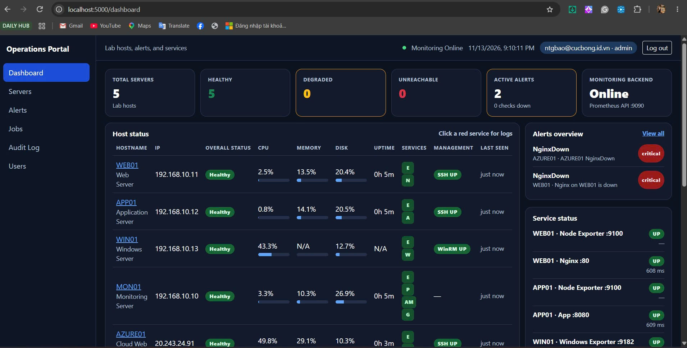

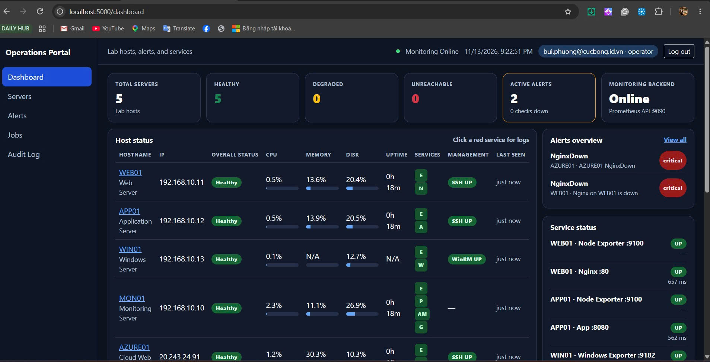

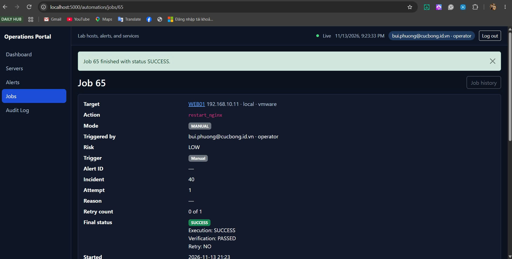

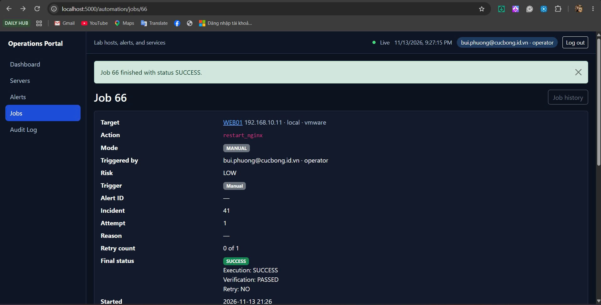

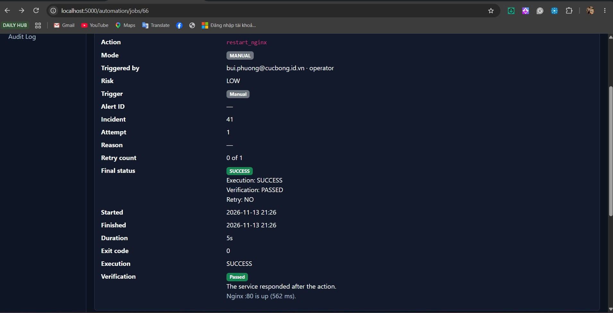

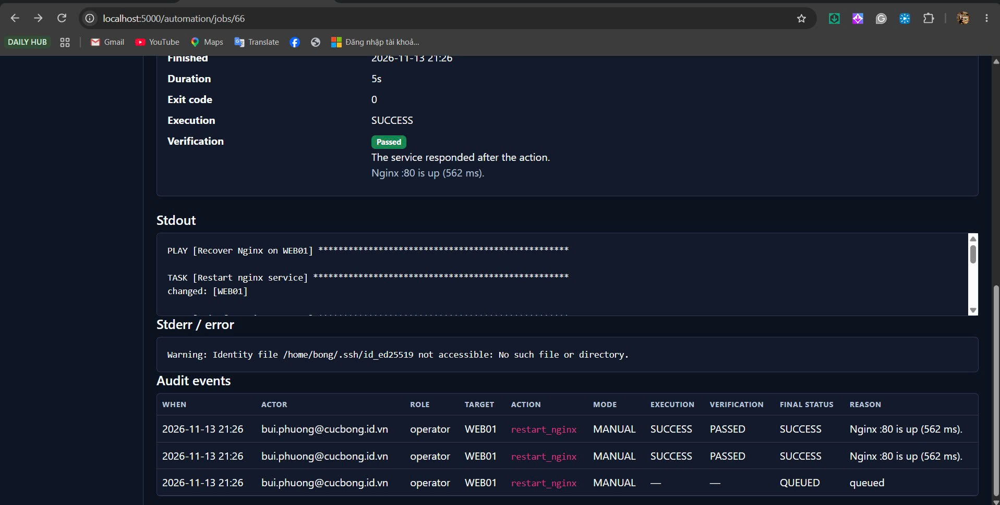

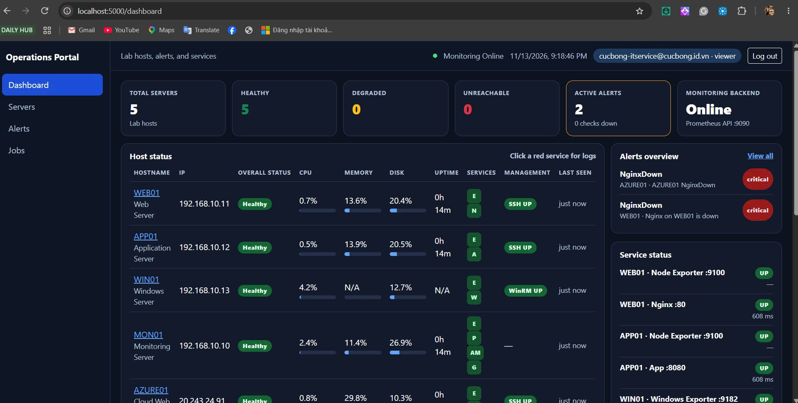

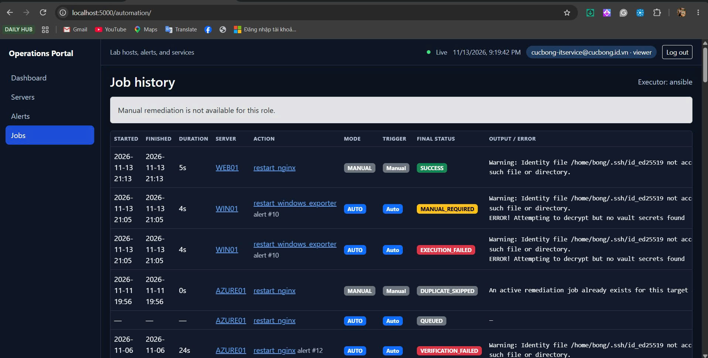

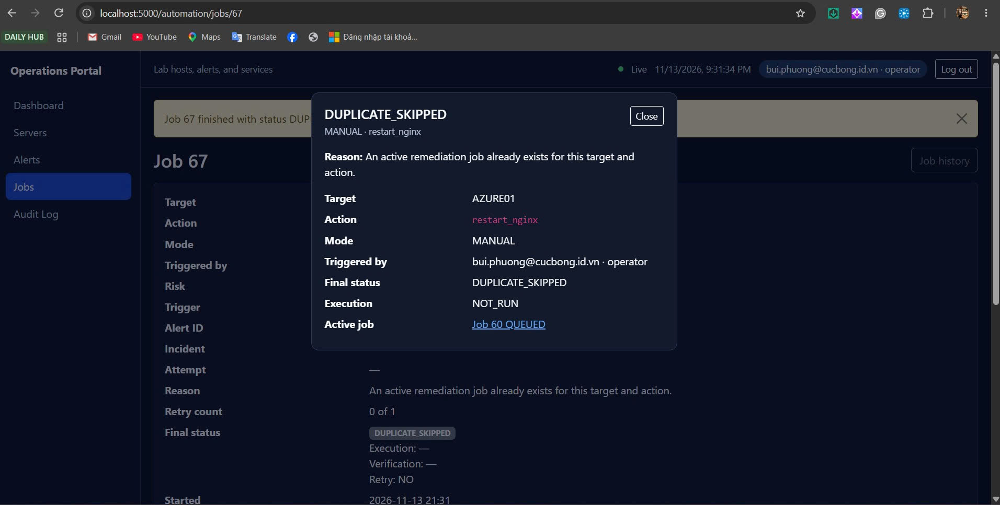

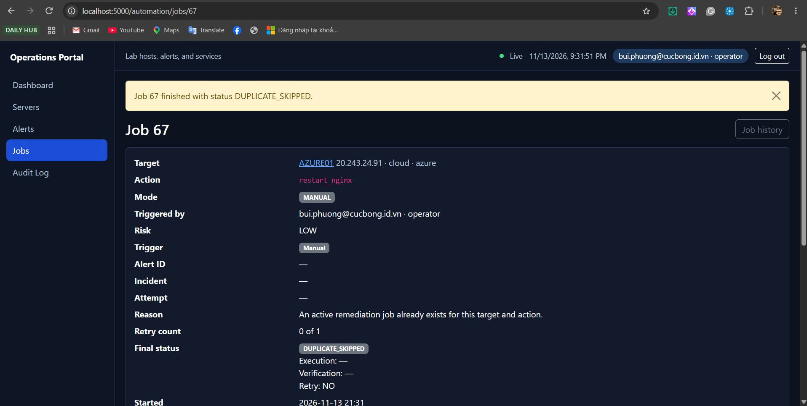

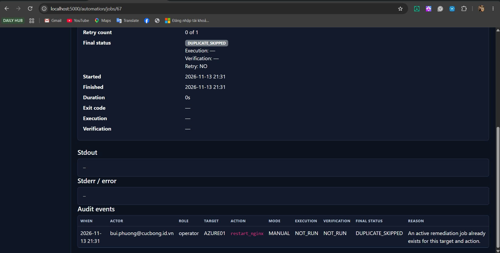

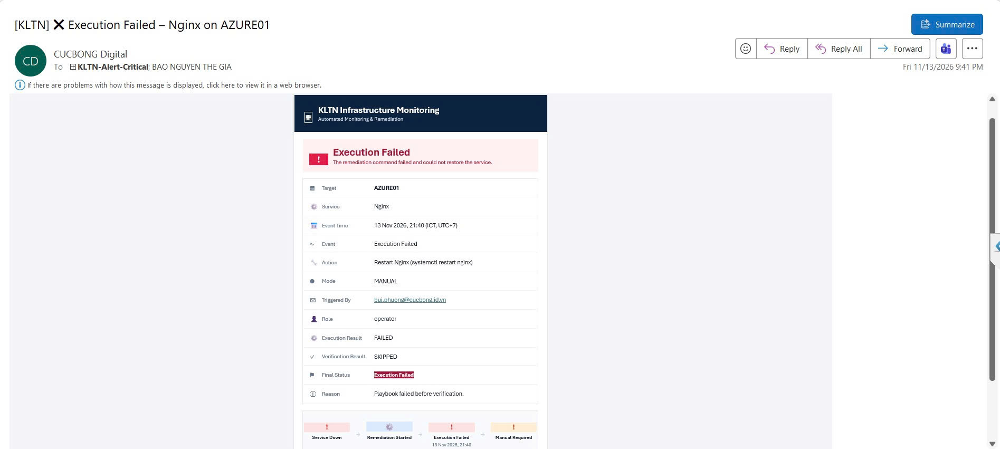

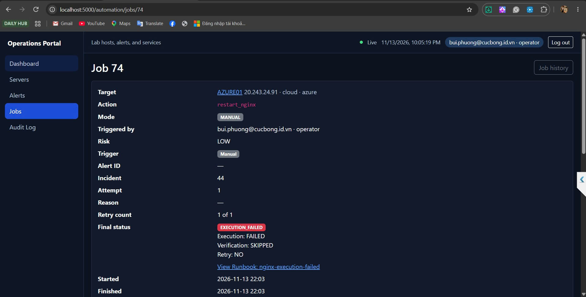

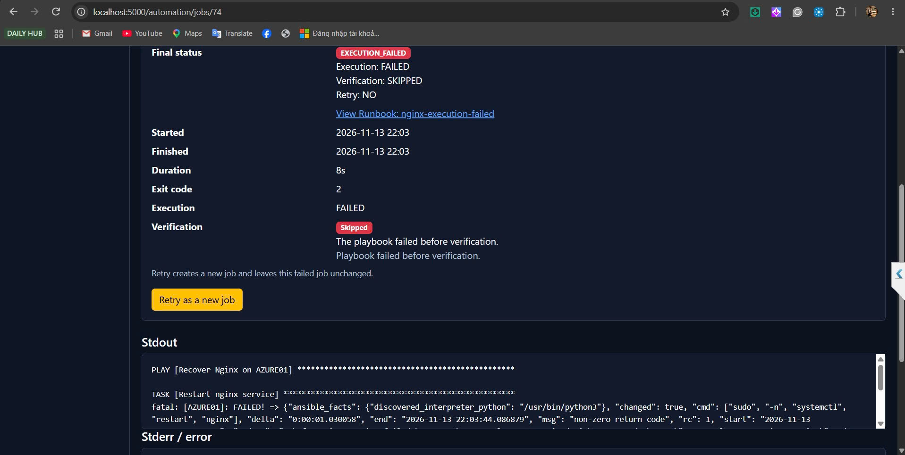

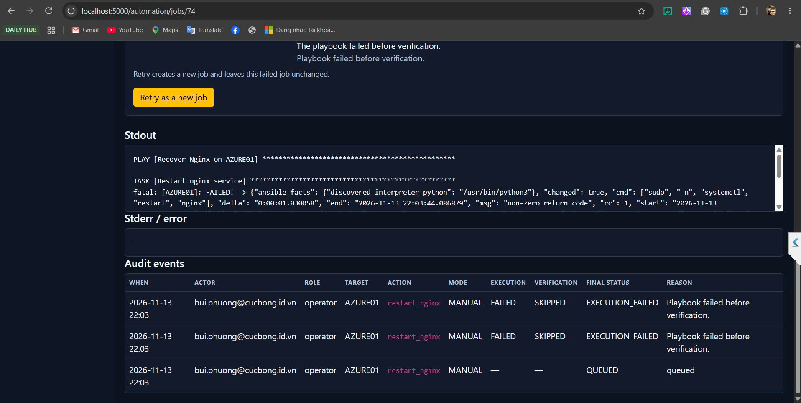

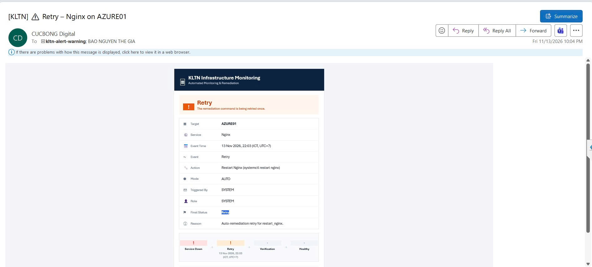

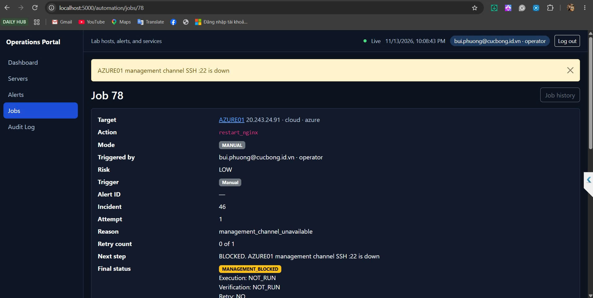

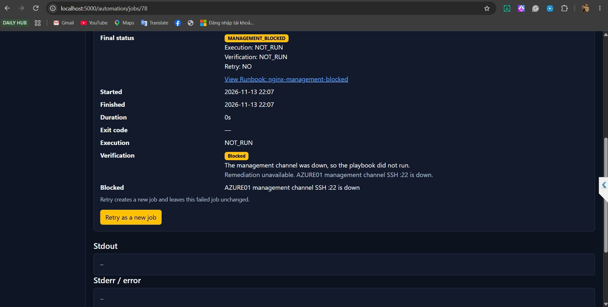

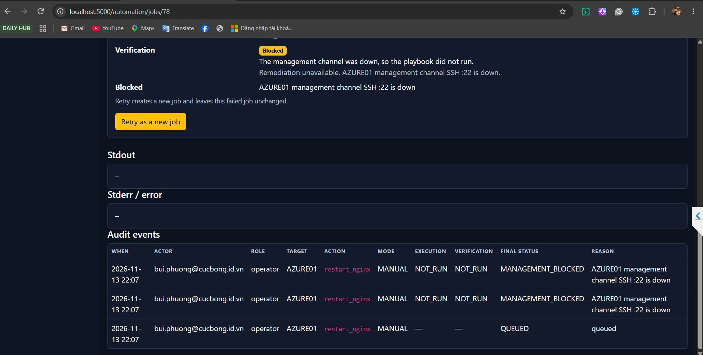

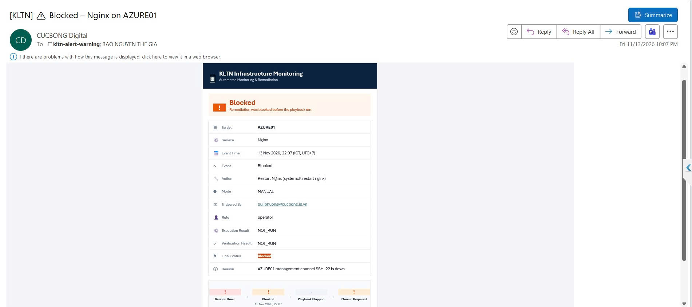

## Khai báo sử dụng AI

Công cụ: Cursor (Grok), dùng khi viết code.

Mục đích: Nhờ giữ Manual Remediation cho Admin và Operator, chặn Viewer, ghi audit đủ actor và mode, chặn job trùng, gửi mail Execution Failed, Retry và Blocked, và không đưa SSH key của AZURE01 vào lệnh portal.

Commit code tuần 8: https://github.com/Cucbong30/cloud-infrastructure-monitoring-automation/commit/4960f041ed12294b595016e993720ba209fd6bf8. Commit tuần 7: https://github.com/Cucbong30/cloud-infrastructure-monitoring-automation/commit/c13696e4d637f098e2b3806b7f92937bf43ddf79.

AI gợi ý để key của target trong `/etc/ansible/hosts`, portal chỉ gọi playbook. Manual fail không tự retry. Duplicate ghi DUPLICATE_SKIPPED và không chạy executor.

Phần em tự làm: Em đăng nhập ba role tối 13/11, chạy manual trên WEB01 và AZURE01, sửa inventory trên MON01, gây Nginx config lỗi và tắt SSH, chụp 21 ảnh portal và Outlook, và giữ job 60 đến job 78 trong database. Em chịu trách nhiệm về mã nguồn, kết quả test trên lab và nội dung báo cáo này. Private key không được commit.
