# Báo cáo Tuần 10

Nguyễn Thế Gia Bảo – Application / Integration

## Công việc được phân công

- Phân loại sự cố trước khi chọn action. Container down thì restart container, risk LOW. Docker service down thì restart Docker service, risk MEDIUM. Nginx down và Windows Exporter down lấy action từ runbook, risk LOW. Không rõ nguyên nhân thì không tự chạy playbook.
- Gắn risk và approval vào trang incident. Risk lấy từ runbook, không hardcode thêm một mức riêng trên portal.
- Incident có năm trạng thái: OPEN, ACKNOWLEDGED, IN_PROGRESS, RESOLVED, CLOSED. Mỗi lần chuyển ghi thời gian và actor. Timeline hiện trên trang incident.
- Một sự cố đang mở không tạo incident mới. Sau khi resolved, lần down sau là incident mới và retry_count về 0.
- LOW tự chạy hoặc chạy tay. MEDIUM do hệ thống hoặc operator tạo request, Admin approve. HIGH vẫn chỉ Admin, như tuần 9.
- Recovery cần HTTP 200. HTTP 403 không tính là đã phục hồi. Playbook fail được đọc theo tên task, không chỉ theo exit code.
- Giáo viên nhận xét tuần 9: giữ ghi chú không có ảnh drawer job 71, job 72 và không có khung 403. Timeout của request 11 chỉ có một trạng thái. Tuần 10 mỗi trạng thái incident phải có job hoặc approval thật.

## Kết quả thực hiện

Tuần này em thêm trang Incidents, timeline và bảng `incident_events`. Trạng thái hợp lệ là open sang acknowledged, in_progress hoặc resolved. Acknowledged sang in_progress hoặc resolved. In_progress sang resolved, hoặc quay lại open khi playbook fail. Resolved mới sang closed. Closed không đi tiếp. Acknowledge chỉ từ open. Close chỉ từ resolved. Auto remediation bỏ qua acknowledge và đi thẳng in_progress.

Giờ dưới đây là giờ portal, đã cộng bảy tiếng. Lab chính chạy chiều và tối 28/11 trên `http://localhost:5000`.

### Ghi chú giáo viên còn giữ từ tuần 9

Drawer job 71 và job 72 vẫn không có trong bộ ảnh 28/11. Em không tạo ảnh thay. Database tuần 8 vẫn là job 71 AUTO SUCCESS và job 72 MANUAL SUCCESS, cả hai AZURE01 `restart_nginx`. Trang AZURE01 lúc 15:09 có một link chữ Job 71 SUCCESS nằm trong alert cũ. Đó không phải drawer của job 71.

Khung 403 vẫn không có. Trang Jobs của viewer lúc 22:05 ghi Manual remediation is not available for this role. Câu Permission denied for Operator role vẫn nằm ở test `test_operator_cannot_request_or_approve_a_high_risk_action` trong `tests/test_week9.py`. Viewer acknowledge bị từ chối nằm ở test `test_active_incident_is_reused_until_it_is_closed` trong `tests/test_week10.py`.

Timeout chỉ có một trạng thái. Request 11, MEDIUM, APP01 `restart_docker_service`, hết hạn 20:25 ngày 20/11. Decision APPROVAL_EXPIRED, actor SYSTEM, job trống, playbook không chạy. Ảnh `approval11-expired-audit` của tuần 9 là evidence cuối. Hàng chờ lúc 21:50 và 22:04 ngày 28/11 vẫn hiện đúng dòng đó, status APPROVAL_EXPIRED, job trống. Không còn chỗ nào ghi là đang chờ đối chiếu.

### OPEN

22:18, INC-090, WEB01, `nginx_down`, risk LOW, action Restart Nginx, cause Nginx down. Timeline chỉ có Incident Detected và Remediation Blocked, SSH or WinRM was down. Related Job trống. Nút trên trang là Acknowledge và View Runbook. Database: opened 22:18, event blocked, không có job. 22:22 cùng incident chuyển resolved vì service restored, vẫn không có job success. Ảnh chụp lúc trang còn OPEN.

21:47, INC-088, APP01, `docker_service_down`, risk MEDIUM, cause Docker service down, action Restart Docker. Timeline: Incident Detected, rồi Approval Requested. Request 12, MEDIUM, The playbook was not started. Lúc này chưa có job. Đây là OPEN gắn với approval thật.

16:07, INC-082 WEB01, INC-083 APP01, INC-084 WIN01, INC-085 AZURE01 mở vì management channel unavailable, action_key blocked, không có job. Đến 22:31 bốn incident này vẫn OPEN.

22:23, INC-092 WEB01, INC-093 APP01, INC-094 WIN01, INC-095 AZURE01 mở lại vì kênh quản trị down. Action lần lượt là `restart_nginx`, `restart_docker_service`, `restart_windows_exporter`, `restart_nginx`. Đến 22:31 cả bốn vẫn OPEN, event blocked, không có job. Em chốt các incident này đang mở, không ghi là đã đóng.

### ACKNOWLEDGED

21:30, INC-087, APP01, `container_down`, risk LOW, cause Container down. Job 110 AUTO EXECUTION_FAILED. Job 111 AUTO MANUAL_REQUIRED, retry limit. 21:31 job 112, operator `bui.phuong@cucbong.id.vn`, MANUAL, EXECUTION_FAILED. 21:31 admin `ntgbao@cucbong.id.vn` bấm acknowledge. Event open sang acknowledged, actor admin, không gắn job. Sau đó admin chạy job 113, EXECUTION_FAILED, incident quay lại acknowledged. 22:04 trang INC-087 vẫn badge ACKNOWLEDGED, related job 113, risk LOW, không có approval. Danh sách lúc 22:03 cũng hiện INC-087 ACKNOWLEDGED. Đến lúc đối database, 22:31, status vẫn acknowledged.

### IN_PROGRESS

Auto không đi qua acknowledge.

15:05, INC-074, APP01 container, job 98 AUTO `restart_container` đang chạy rồi SUCCESS. Timeline: Detected, Remediation Started, không có dòng Acknowledged.

15:09, INC-076, AZURE01 Nginx, job 100 AUTO `restart_nginx` RUNNING trên trang incident, badge IN_PROGRESS. Drawer host ghi Incident 76 opened for restart_nginx on AZURE01. Job 100 sau đó SUCCESS, verification PASSED, alert NginxDown #12 resolved.

15:14, INC-077, APP01 container, badge IN_PROGRESS, related job 103. Timeline có Detected, Remediation Started job 101, Execution Failed, Retry job 102, Execution Failed vì retry limit, rồi operator chạy tiếp. Job 104 của operator fail đúng task Start app01-web, rc 1, dòng Playbook failed before verification. Audit ghi execution FAILED, verification SKIPPED, final EXECUTION_FAILED.

### RESOLVED

Recovery trong lab này là HTTP 200, không phải chỉ có cổng mở.

14:54, INC-069, WEB01, job 93 AUTO `restart_nginx` SUCCESS. Drawer ghi Incident 69 resolved (success). The next failure starts a new incident at retry_count 0. Dòng dưới: Nginx HTTP 200 verified (HTTP 200 (593 ms)). Trang incident lúc đó badge RESOLVED, có nút Close Incident, related job 93.

15:01, INC-070, job 94, cùng kiểu, HTTP 200 (547 ms), badge RESOLVED, nút Close Incident.

15:07, INC-075, WIN01, job 99 AUTO `restart_windows_exporter` SUCCESS. Timeline Detected, Remediation Started, Incident Resolved, Recovery confirmed. Badge RESOLVED. Drawer ghi Metrics HTTP 200 on port 9182 verified (HTTP 200 (1078 ms)).

21:50, INC-088 sau khi Admin approve request 12. Job 114 MANUAL, risk MEDIUM, approval APPROVED, requester SYSTEM, approver admin, final SUCCESS. Timeline đủ Approval Requested, Approval Approved, Remediation Started, Incident Resolved. Trang incident badge RESOLVED, assigned to admin, related job 114. Banner job: Approved. Job 114 finished with status SUCCESS. Incident này resolved, chưa closed.

21:54, INC-089, WEB01, job 115 AUTO `restart_nginx` SUCCESS, incident 89. Audit verification passed, Nginx HTTP 200 verified (HTTP 200 (610 ms)). Trang incident badge RESOLVED, cause Nginx down, risk LOW, related job 115, nút Close Incident. Database đến 22:31 vẫn là resolved, chưa closed. 21:54 drawer còn một dòng Auto-remediation skipped: service is up, vì Nginx đã trả lời, playbook không chạy thêm lần nữa.

15:48 INC-078 và 21:16 INC-086 cũng resolved vì service restored sau các job fail. Không có job SUCCESS trên hai incident đó. Em không gọi chúng là closed.

### CLOSED

Close chỉ bấm được khi status đã là resolved. Database có event resolved sang closed:

- INC-069 đến INC-075, actor `ntgbao@cucbong.id.vn`, role admin, khoảng 15:08 đến 15:09.
- INC-076 và INC-077, actor `bui.phuong@cucbong.id.vn`, role operator, 15:48.

Ảnh chụp các trang này dừng ở badge RESOLVED và nút Close Incident. Bộ zip 48 khung không có badge CLOSED. Em không tạo ảnh thay. Trạng thái đóng lấy từ `incident_events`, có actor và giờ.

INC-088, INC-089, INC-090, INC-091 đến 22:31 vẫn resolved, chưa có event closed. INC-087 vẫn acknowledged.

### Phân loại và approval gắn trên incident

Runbook `restart-app-container` ghi APP01, container app01-web, playbook `restart-app-container.yml`, risk LOW. Post-check là HTTP 200 trên cổng 8080. Trang incident hiện đúng câu LOW runs after the usual pre-check. It does not open an approval request.

INC-088 lấy cause Docker service down nên action là Restart Docker và risk MEDIUM. Request 12 tạo lúc 21:47, mode AUTO, requester SYSTEM, expires 21:52. 21:50 Admin approve. Execution started 21:50, execution SUCCESS, verification PASSED, job 114. 21:50 hàng chờ còn request 12 PENDING_APPROVAL. 22:04 history đã là APPROVED, job 114, và ngay trên đó vẫn là request 11 APPROVAL_EXPIRED.

Cooldown vẫn còn. 15:04 drawer APP01 ghi Auto-remediation skipped: cooldown, vì job 95 vừa chạy `restart_container`, lần auto sau được tính từ 15:05.

### Việc còn mở lúc 22:31

INC-082, INC-083, INC-084, INC-085 mở từ 16:07, blocked, chưa có job. INC-092, INC-093, INC-094, INC-095 mở từ 22:23, blocked, chưa có job. INC-087 vẫn ACKNOWLEDGED sau job 113 fail. Các incident resolved chưa bấm close là INC-078, INC-086, INC-088, INC-089, INC-090, INC-091.

## GitHub

| Kết quả | Commit message | Link | Commit |
| --- | --- | --- | --- |
| Code tuần 10 | Add the incident lifecycle and link each state to its job or approval. | https://github.com/Cucbong30/cloud-infrastructure-monitoring-automation/tree/1ee9c98d7ea88e154ed62d783e4b11e46d18b33f/application | https://github.com/Cucbong30/cloud-infrastructure-monitoring-automation/commit/1ee9c98d7ea88e154ed62d783e4b11e46d18b33f |
| Vòng đời incident | Add the incident lifecycle and link each state to its job or approval. | https://github.com/Cucbong30/cloud-infrastructure-monitoring-automation/blob/1ee9c98d7ea88e154ed62d783e4b11e46d18b33f/application/app/services/incidents.py | https://github.com/Cucbong30/cloud-infrastructure-monitoring-automation/commit/1ee9c98d7ea88e154ed62d783e4b11e46d18b33f |
| Trang incident | Add the incident lifecycle and link each state to its job or approval. | https://github.com/Cucbong30/cloud-infrastructure-monitoring-automation/blob/1ee9c98d7ea88e154ed62d783e4b11e46d18b33f/application/app/blueprints/incidents.py | https://github.com/Cucbong30/cloud-infrastructure-monitoring-automation/commit/1ee9c98d7ea88e154ed62d783e4b11e46d18b33f |
| Runbook và risk | Add the incident lifecycle and link each state to its job or approval. | https://github.com/Cucbong30/cloud-infrastructure-monitoring-automation/blob/1ee9c98d7ea88e154ed62d783e4b11e46d18b33f/application/app/services/runbooks.py | https://github.com/Cucbong30/cloud-infrastructure-monitoring-automation/commit/1ee9c98d7ea88e154ed62d783e4b11e46d18b33f |
| HTTP 200 mới là recovery | Add the incident lifecycle and link each state to its job or approval. | https://github.com/Cucbong30/cloud-infrastructure-monitoring-automation/blob/1ee9c98d7ea88e154ed62d783e4b11e46d18b33f/application/app/services/probes.py | https://github.com/Cucbong30/cloud-infrastructure-monitoring-automation/commit/1ee9c98d7ea88e154ed62d783e4b11e46d18b33f |
| Bảng lifecycle | Add the incident lifecycle and link each state to its job or approval. | https://github.com/Cucbong30/cloud-infrastructure-monitoring-automation/blob/1ee9c98d7ea88e154ed62d783e4b11e46d18b33f/application/migrations/versions/e7c1a9d44b10_incident_lifecycle.py | https://github.com/Cucbong30/cloud-infrastructure-monitoring-automation/commit/1ee9c98d7ea88e154ed62d783e4b11e46d18b33f |
| Test tuần 10 | Add the incident lifecycle and link each state to its job or approval. | https://github.com/Cucbong30/cloud-infrastructure-monitoring-automation/blob/1ee9c98d7ea88e154ed62d783e4b11e46d18b33f/application/tests/test_week10.py | https://github.com/Cucbong30/cloud-infrastructure-monitoring-automation/commit/1ee9c98d7ea88e154ed62d783e4b11e46d18b33f |
| Code tuần 9 | Gate medium and high remediation behind admin approval. | https://github.com/Cucbong30/cloud-infrastructure-monitoring-automation/commit/b95ad447b07e58401e4296b4bd67a15852064998 | https://github.com/Cucbong30/cloud-infrastructure-monitoring-automation/commit/b95ad447b07e58401e4296b4bd67a15852064998 |
| Báo cáo tuần 9 | Link the week 9 screenshots and report to their commit. | https://github.com/Cucbong30/cloud-infrastructure-monitoring-automation/tree/54efe804567064a26b4856a9bdf7ebc3494a552e/application/docs/week09 | https://github.com/Cucbong30/cloud-infrastructure-monitoring-automation/commit/54efe804567064a26b4856a9bdf7ebc3494a552e |
| Ảnh hết hạn request 11 | Link the week 9 screenshots and report to their commit. | https://github.com/Cucbong30/cloud-infrastructure-monitoring-automation/blob/54efe804567064a26b4856a9bdf7ebc3494a552e/application/docs/week09/screenshots/approval11-expired-audit.jpg | https://github.com/Cucbong30/cloud-infrastructure-monitoring-automation/commit/54efe804567064a26b4856a9bdf7ebc3494a552e |
| Thư mục tuần 10 | Add the week 10 incident lifecycle report and lab screenshots. | https://github.com/Cucbong30/cloud-infrastructure-monitoring-automation/tree/__DOCS_SHA__/application/docs/week10 | https://github.com/Cucbong30/cloud-infrastructure-monitoring-automation/commit/__DOCS_SHA__ |
| Báo cáo Word tuần 10 | Add the week 10 incident lifecycle report and lab screenshots. | https://github.com/Cucbong30/cloud-infrastructure-monitoring-automation/blob/__DOCS_SHA__/application/docs/week10/week-10-application.docx | https://github.com/Cucbong30/cloud-infrastructure-monitoring-automation/commit/__DOCS_SHA__ |
| OPEN, không có job | Add the week 10 incident lifecycle report and lab screenshots. | https://github.com/Cucbong30/cloud-infrastructure-monitoring-automation/blob/__DOCS_SHA__/application/docs/week10/screenshots/inc90-open-blocked.jpg | https://github.com/Cucbong30/cloud-infrastructure-monitoring-automation/commit/__DOCS_SHA__ |
| OPEN kèm request 12 | Add the week 10 incident lifecycle report and lab screenshots. | https://github.com/Cucbong30/cloud-infrastructure-monitoring-automation/blob/__DOCS_SHA__/application/docs/week10/screenshots/inc88-open-approval.jpg | https://github.com/Cucbong30/cloud-infrastructure-monitoring-automation/commit/__DOCS_SHA__ |
| ACKNOWLEDGED | Add the week 10 incident lifecycle report and lab screenshots. | https://github.com/Cucbong30/cloud-infrastructure-monitoring-automation/blob/__DOCS_SHA__/application/docs/week10/screenshots/inc87-acknowledged.jpg | https://github.com/Cucbong30/cloud-infrastructure-monitoring-automation/commit/__DOCS_SHA__ |
| IN_PROGRESS | Add the week 10 incident lifecycle report and lab screenshots. | https://github.com/Cucbong30/cloud-infrastructure-monitoring-automation/blob/__DOCS_SHA__/application/docs/week10/screenshots/inc76-in-progress.jpg | https://github.com/Cucbong30/cloud-infrastructure-monitoring-automation/commit/__DOCS_SHA__ |
| RESOLVED HTTP 200 | Add the week 10 incident lifecycle report and lab screenshots. | https://github.com/Cucbong30/cloud-infrastructure-monitoring-automation/blob/__DOCS_SHA__/application/docs/week10/screenshots/inc89-resolved.jpg | https://github.com/Cucbong30/cloud-infrastructure-monitoring-automation/commit/__DOCS_SHA__ |
| MEDIUM approved | Add the week 10 incident lifecycle report and lab screenshots. | https://github.com/Cucbong30/cloud-infrastructure-monitoring-automation/blob/__DOCS_SHA__/application/docs/week10/screenshots/job114-approved-success.jpg | https://github.com/Cucbong30/cloud-infrastructure-monitoring-automation/commit/__DOCS_SHA__ |
| Request 11 vẫn hết hạn | Add the week 10 incident lifecycle report and lab screenshots. | https://github.com/Cucbong30/cloud-infrastructure-monitoring-automation/blob/__DOCS_SHA__/application/docs/week10/screenshots/approval-queue-request11-expired.jpg | https://github.com/Cucbong30/cloud-infrastructure-monitoring-automation/commit/__DOCS_SHA__ |

## Luồng đã kiểm tra

- OPEN có approval, chưa có job: INC-088, request 12, 21:47.
- OPEN bị chặn kênh quản trị, không có job: INC-090 lúc 22:18. INC-082 đến INC-085 và INC-092 đến INC-095 còn mở lúc 22:31.
- ACKNOWLEDGED: INC-087, admin acknowledge 21:31, job 110 đến job 113 đều fail, status giữ acknowledged.
- IN_PROGRESS, auto bỏ qua acknowledge: INC-074 job 98, INC-076 job 100, INC-077 job 103.
- RESOLVED bằng HTTP 200: INC-069 job 93 (593 ms), INC-070 job 94 (547 ms), INC-075 job 99 (1078 ms), INC-089 job 115 (610 ms).
- RESOLVED sau approval MEDIUM: INC-088, request 12, job 114 SUCCESS.
- CLOSED trong database: INC-069 đến INC-077. Ảnh chỉ tới nút Close Incident, không có badge CLOSED.
- Request 11: APPROVAL_EXPIRED từ 20:25 ngày 20/11, hàng chờ 28/11 vẫn hiện đúng một status đó.
- Viewer không có nút manual. Không có ảnh trang 403. Không có drawer job 71 và job 72.
- Lần down sau khi resolved là incident mới, retry_count 0. Drawer INC-069 và INC-070 ghi câu này.
- Playbook fail theo tên task: job 104, task Start app01-web, rc 1, verification SKIPPED.

## Ảnh test case

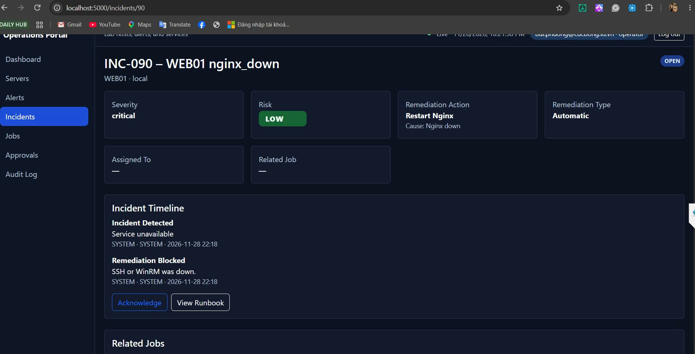

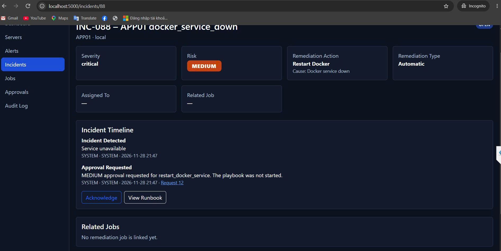

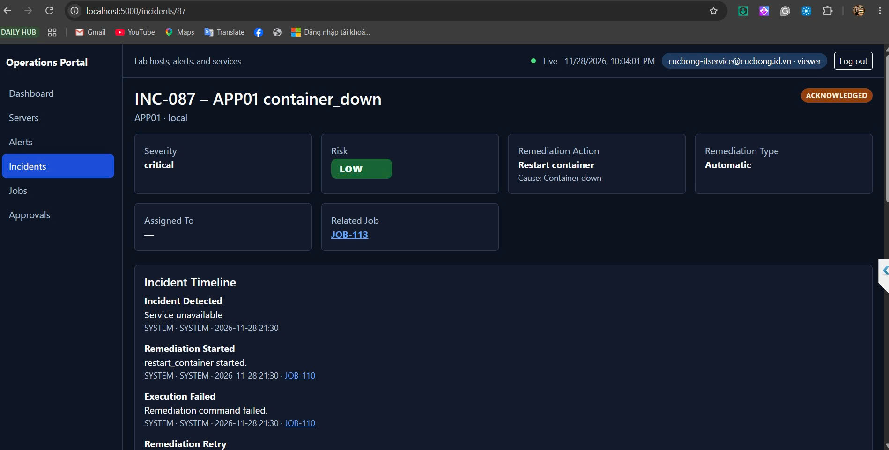

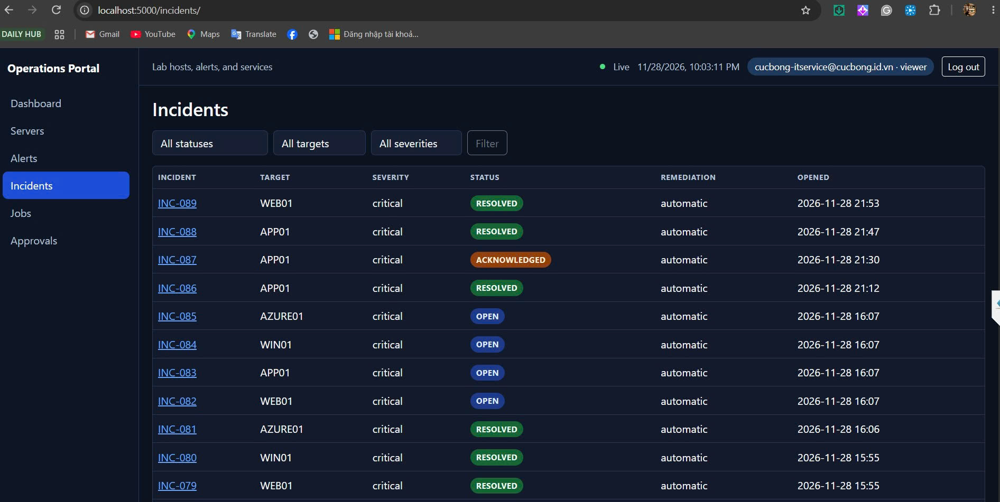

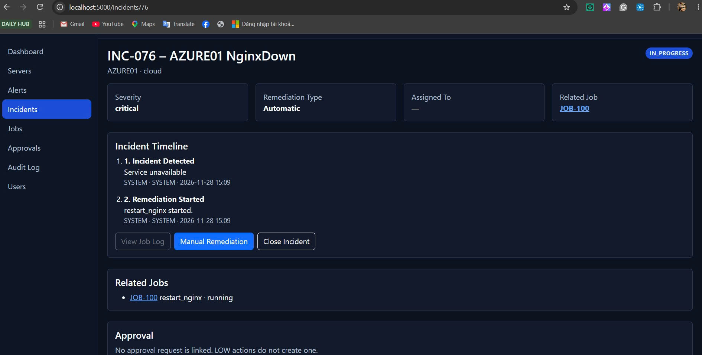

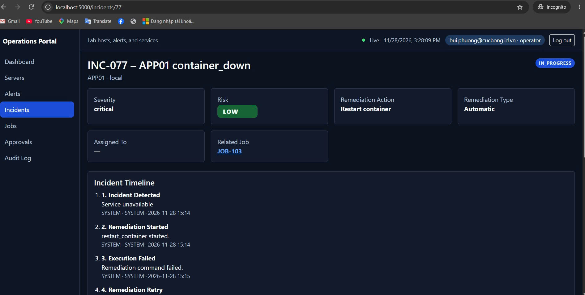

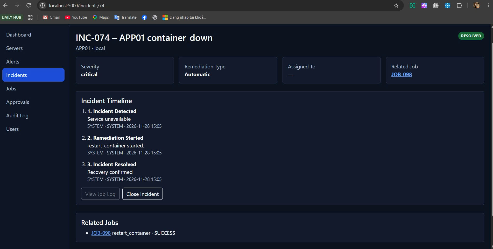

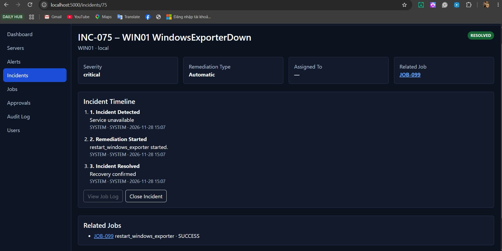

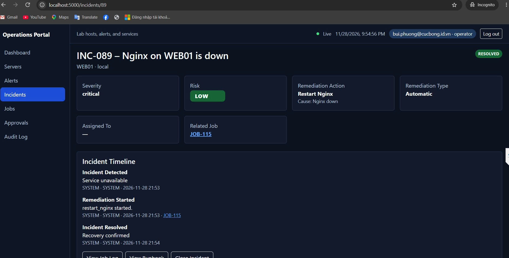

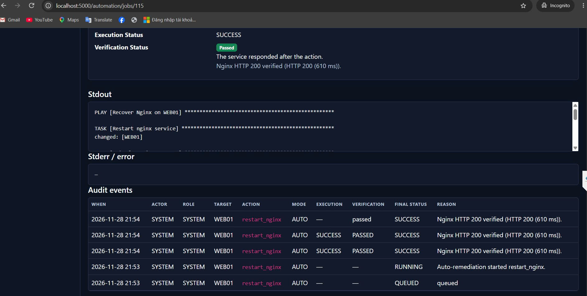

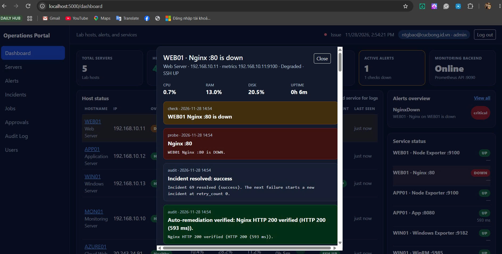

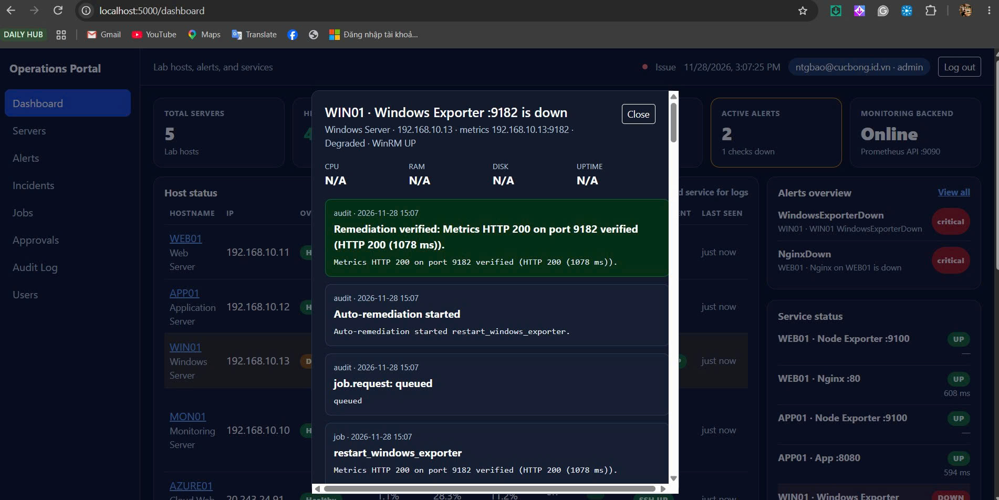

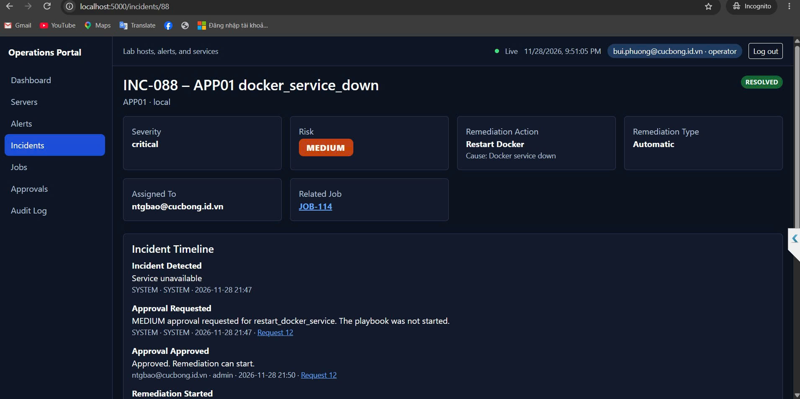

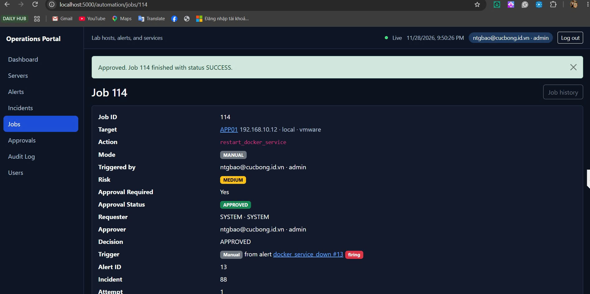

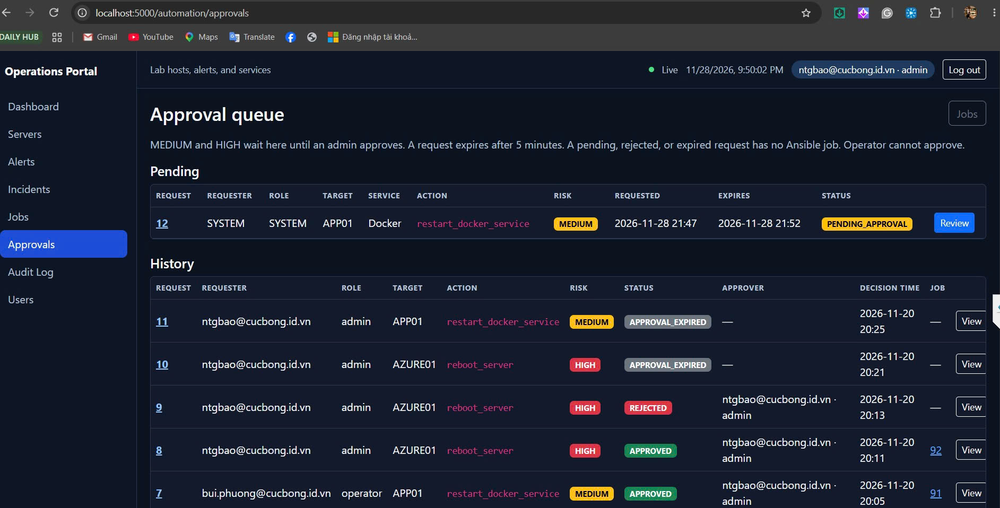

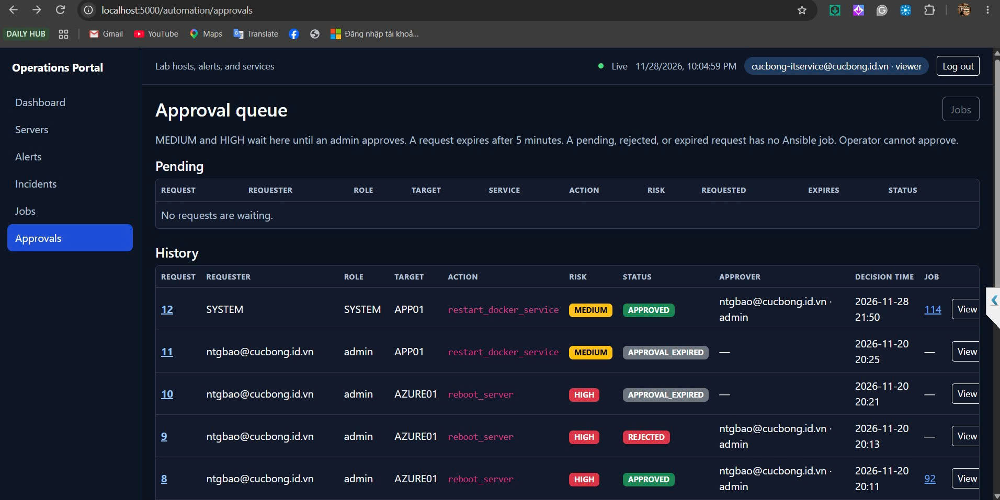

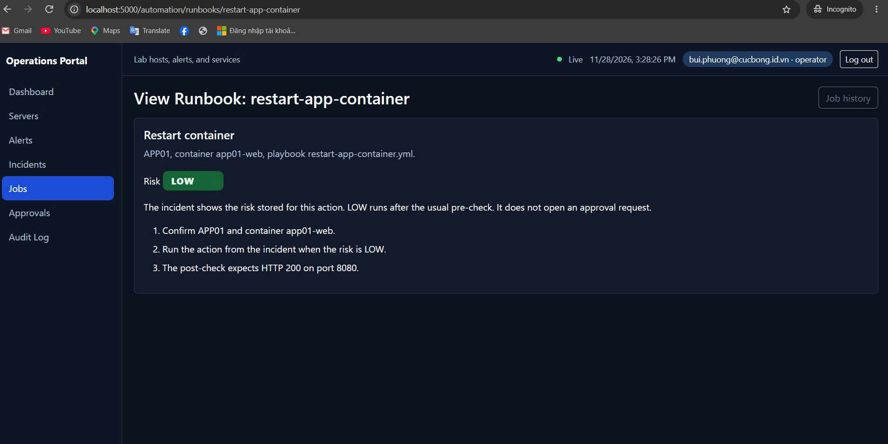

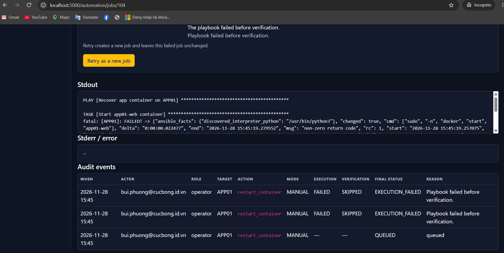

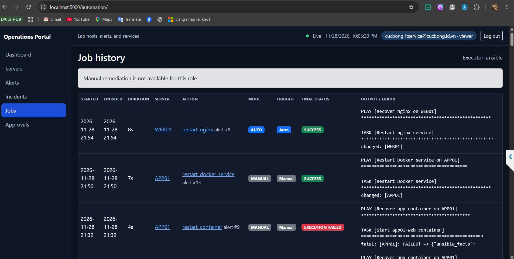

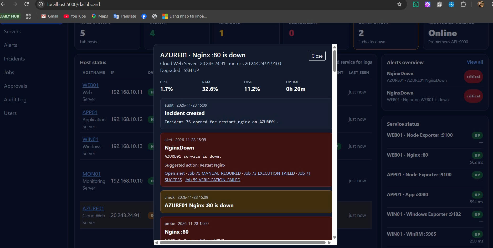

## Khai báo sử dụng AI

Công cụ: Cursor (Grok), dùng khi viết code.

Mục đích: Nhờ làm incident lifecycle năm trạng thái, timeline, gắn incident với alert, job và approval, và lấy risk từ runbook. HTTP 200 mới tính là recovery.

Commit code tuần 10: https://github.com/Cucbong30/cloud-infrastructure-monitoring-automation/commit/1ee9c98d7ea88e154ed62d783e4b11e46d18b33f. Commit tuần 9: https://github.com/Cucbong30/cloud-infrastructure-monitoring-automation/commit/b95ad447b07e58401e4296b4bd67a15852064998.

AI gợi ý auto bỏ qua acknowledge, close chỉ từ resolved, và không tạo incident mới khi sự cố cũ còn active.

Phần em tự làm: Em chạy lab chiều và tối 28/11, chụp 48 ảnh, và đối database để gắn từng trạng thái với job hoặc approval. Request 11 giữ một trạng thái APPROVAL_EXPIRED. Bộ ảnh không có badge CLOSED, không có drawer job 71, job 72 và không có trang 403. Em chịu trách nhiệm về mã nguồn, kết quả test trên lab và nội dung báo cáo này.
