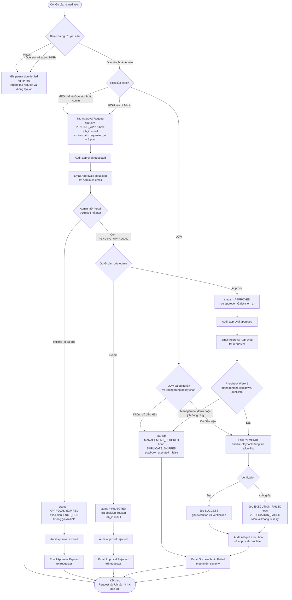
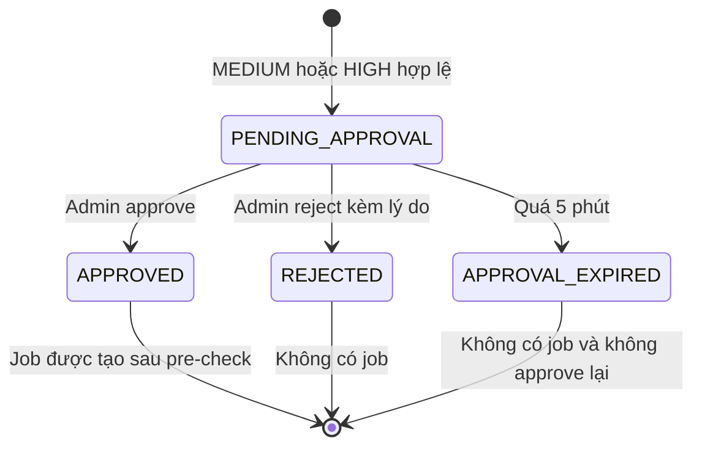

# DG-06 – Approval Workflow

**Đề tài:** Xây dựng hệ thống giám sát và tự động hóa vận hành hạ tầng trong môi trường Hybrid Cloud  
**Phụ trách:** Nguyễn Thế Gia Bảo – Application / Integration  
**Baseline:** Approval service, RBAC và hàng đợi trên Operations Portal, Tuần 9  
**Timeout hiện hành:** `APPROVAL_TIMEOUT_MINUTES = 5`

## 1. Mục đích

Activity Diagram mô tả điều kiện một remediation action được chạy Ansible. Request và Job là hai đối tượng riêng. Trạng thái chờ duyệt, bị từ chối hoặc hết hạn không có job thực thi.

Email dùng Microsoft Graph đã cấu hình từ Tuần 7. Email có Request ID, target, action, risk và trạng thái, có thể có link mở request trên Portal. Email không có nút Approve.

## 2. Phân quyền

| Thao tác | Viewer | Operator | Admin |
|---|---|---|---|
| Xem request | Có | Có | Có |
| Request LOW | Không | Có | Có |
| Request MEDIUM | Không | Có | Có |
| Request HIGH | Không | Không | Có |
| Approve hoặc Reject MEDIUM | Không | Không | Có |
| Approve hoặc Reject HIGH | Không | Không | Có |

Operator không tự duyệt request của mình hay của người khác. Admin trong lab được duyệt cả request do chính Admin tạo, vì môi trường có một tài khoản quản trị. Viewer bị từ chối ở backend bằng HTTP 403, không chỉ bằng việc ẩn nút.

## 3. Phân loại rủi ro

| Target | Action | Risk | Cách xử lý |
|---|---|---|---|
| WEB01 | `restart_nginx` | LOW | Chạy sau pre-check. Không tạo approval request. |
| APP01 | `restart_container` | LOW | Auto và manual đều được chạy khi đủ policy. |
| WIN01 | `restart_windows_exporter` | LOW | Auto và manual đều được chạy khi đủ policy. |
| AZURE01 | `restart_nginx` | LOW | Dùng playbook `restart-azure-nginx.yml`. |
| APP01 | `restart_docker_service` | MEDIUM | Tạo request. Ansible chỉ chạy sau khi Admin approve. |
| AZURE01 | `reboot_server` | HIGH | Chỉ Admin được request. Ansible chỉ chạy sau khi Admin approve. |

Auto-remediation chỉ thực thi action LOW. Nếu một action medium hoặc high được gắn vào cảnh báo tự động, Portal tạo request với actor SYSTEM và không chạy playbook. SYSTEM không có quyền duyệt.

Nút Retry, cảnh báo AUTO và lời gọi dispatch trực tiếp đều đi qua cùng cổng này. Chúng không được tạo job khi action còn cần duyệt.

## 4. Activity Diagram

Cổng thực thi sau khi đã có quyết định:

| Điều kiện | Ansible |
|---|---|
| LOW và người dùng có quyền | Được chạy, sau pre-check, cooldown, duplicate và verification. |
| MEDIUM hoặc HIGH đang `PENDING_APPROVAL` | Không chạy. |
| MEDIUM hoặc HIGH đã `APPROVED` | Được chạy, rồi áp dụng lại policy Tuần 6. |
| `REJECTED`, `APPROVAL_EXPIRED` hoặc không đủ quyền | Không chạy. |

Với `reboot_server`, verification của Portal chỉ đạt khi SSH cổng 22 và Nginx đều trả lời sau khi máy khởi động lại. Thời gian chờ Ansible của riêng reboot là 420 giây để playbook `reboot-azure01.yml` có thể chờ tối đa 300 giây.

## 5. Vòng đời request

Hết hạn được kiểm tra khi mở hàng đợi, mở chi tiết và trước lúc ghi quyết định. Request đã hết hạn không được approve thành công.

Nếu đã có request pending cùng server và cùng action, Portal trả lại request đó và không gửi thêm email request mới.

## 6. Giao diện

Menu **Operations → Approvals** có hai phần:

- **Pending:** request còn `PENDING_APPROVAL`, gồm requester, role, target, service, action, risk, thời điểm yêu cầu và thời điểm hết hạn.
- **History:** request đã approved, rejected hoặc expired, gồm approver, thời điểm quyết định và job nếu có.

Nút **Review** và việc bấm vào dòng mở chi tiết. Nút **Approve** và **Reject** chỉ render khi user là Admin và request còn pending. Reject bắt buộc có lý do.

## 7. Audit và email

| Sự kiện | Audit | Người nhận email |
|---|---|---|
| Tạo request | `approval.requested` | Admin đang active và có email |
| Approve | `approval.approved`, sau khi chạy xong có `approval.completed` | Requester khi approve; kết quả chạy gửi theo severity |
| Reject | `approval.rejected` | Requester |
| Hết hạn | `approval.expired` | Requester |
| Từ chối quyền | `permission.denied` | Không gửi mail duyệt |
| Chạy xong | audit remediation kèm job ID | Nhóm Critical, Warning hoặc Info đã cấu hình |

Mỗi dòng audit của approval lưu được request ID, requester, requester role, approver, risk, decision, thời điểm, job ID, execution result và verification result. Màn Audit lọc theo ngày ICT và theo đúng tên action.

`approval.completed` được ghi để nối request với kết quả job. Sự kiện này không gửi thêm một email riêng; email kết quả vẫn là email remediation.

## 8. Trường bắt buộc của request

`request_id`, `requester`, `requester_role`, `target`, `action`, `risk`, `mode`, `status`, `requested_at`, `expires_at`, `approver`, `decision_at`, `decision_reason`, `job_id`.

Trước khi approve, approver, decision time, decision reason và job ID để trống. Execution và verification của request chưa chạy là `NOT_RUN`.

## 9. Tài liệu liên quan

- [SRS – FR-APR và RULE-13, RULE-14](../SRS.md)
- [SDD – Approval Workflow Design](../SDD.md)
- [DG-03 Use Case](use-case-diagram.md)
- [DG-04 Database ERD](database-erd.md)
- [DG-05 Remediation Sequence](remediation-sequence.md)
