# DG-04 – Database ERD

**Đề tài:** Xây dựng hệ thống giám sát và tự động hóa vận hành hạ tầng trong môi trường Hybrid Cloud  
**Phụ trách:** Nguyễn Thế Gia Bảo – Application / Integration  
**Baseline:** SQLAlchemy models trong `app/models.py` và migrations đến revision `d4b8f1c06a22`  
**Database:** SQLite, file nghiệp vụ của Portal là `instance/portal.db` trên máy chạy Flask

## 1. Mục đích

Sơ đồ mô tả các bảng đang được Portal lưu, khóa chính, khóa ngoại và quan hệ giữa Users, Servers, Alerts, Automation Jobs, Incidents, Approval Requests và Audit Logs.

Phần **đã triển khai** là column và constraint có trong model hiện tại. Phần **dự kiến Tuần 10** được liệt kê riêng và không vẽ thành bảng vì chưa có migration.

Portal không lưu time-series. CPU, RAM, Disk và Uptime được truy vấn từ Prometheus khi người dùng mở Dashboard.

## 2. ERD đã triển khai

```mermaid
erDiagram
    USERS ||--o{ ALERTS : "acknowledged_by"
    USERS ||--o{ AUTOMATION_JOBS : "requested_by"
    USERS ||--o{ APPROVAL_REQUESTS : "requester_id"
    USERS ||--o{ APPROVAL_REQUESTS : "approver_id"
    USERS ||--o{ AUDIT_LOGS : "user_id"
    SERVERS ||--o{ ALERTS : "server_id"
    SERVERS ||--o{ AUTOMATION_JOBS : "server_id"
    SERVERS ||--o{ INCIDENTS : "server_id"
    SERVERS ||--o{ APPROVAL_REQUESTS : "server_id"
    ALERTS ||--o{ AUTOMATION_JOBS : "alert_id"
    ALERTS ||--o{ INCIDENTS : "alert_id"
    ALERTS ||--o{ APPROVAL_REQUESTS : "alert_id"
    INCIDENTS ||--o{ AUTOMATION_JOBS : "incident_id"
    INCIDENTS ||--o{ APPROVAL_REQUESTS : "incident_id"
    AUTOMATION_JOBS ||--o| APPROVAL_REQUESTS : "job_id"

    USERS {
        int id PK
        string username UK
        string password_hash
        string email
        string entra_oid UK
        string role
        bool is_active
        datetime last_login_at
        datetime created_at
    }
    SERVERS {
        int id PK
        string name UK
        string hostname
        string ip_address
        string environment
        string provider
        string os_type
        string status
        string monitoring_target
        string automation_group
        string azure_resource_id
        bool is_active
        datetime last_seen_at
        datetime created_at
        datetime updated_at
    }
    ALERTS {
        int id PK
        int server_id FK
        int acknowledged_by FK
        string fingerprint
        string alert_name
        string category
        string source
        string severity
        string status
        string summary
        text description
        datetime starts_at
        datetime acknowledged_at
        datetime resolved_at
        datetime created_at
    }
    INCIDENTS {
        int id PK
        int server_id FK
        int alert_id FK
        string action_key
        string status
        int retry_count
        bool manual_required
        bool verification_failed
        bool blocked
        string reason
        datetime opened_at
        datetime closed_at
    }
    AUTOMATION_JOBS {
        int id PK
        int server_id FK
        int alert_id FK
        int requested_by FK
        int incident_id FK
        int retry_of_job_id
        string trigger_source
        string executor
        string action_key
        text parameters_json
        string status
        int exit_code
        text output_excerpt
        text stderr_excerpt
        string verification_result
        text verification_detail
        text block_reason
        int attempt
        string final_status
        string reason
        string mode
        string triggered_by
        string user_email
        string user_role
        datetime started_at
        datetime finished_at
        datetime created_at
    }
    APPROVAL_REQUESTS {
        int id PK
        int server_id FK
        int alert_id FK
        int job_id FK
        int incident_id FK
        int requester_id FK
        int approver_id FK
        string action_key
        string service
        string risk
        string mode
        text parameters_json
        string status
        string requester_name
        string requester_role
        string approver_name
        string approver_role
        string decision
        string decision_reason
        string execution_result
        string verification_result
        string final_status
        datetime requested_at
        datetime expires_at
        datetime decision_at
        datetime execution_started_at
    }
    AUDIT_LOGS {
        int id PK
        int user_id FK
        string action
        string resource_type
        string resource_id
        text details_json
        string ip_address
        datetime created_at
    }
```

`AUTOMATION_JOBS.retry_of_job_id` là số nguyên tự tham chiếu về job trước đó. Model hiện tại không khai báo Foreign Key cho cột này. Quan hệ retry vì vậy là quan hệ logic, không bị database cưỡng bức.

Một Approval Request trỏ tới tối đa một Job. Request đang `PENDING_APPROVAL`, `REJECTED` hoặc `APPROVAL_EXPIRED` có `job_id` rỗng.

## 3. Khóa và ràng buộc

| Bảng | Primary Key | Unique | Check |
|---|---|---|---|
| `users` | `id` | `username`, `entra_oid` | `role` thuộc `admin`, `operator`, `viewer` |
| `servers` | `id` | `name` | `os_type` thuộc `linux`, `windows`; `status` thuộc `online`, `warning`, `down`, `maintenance`, `unknown` |
| `alerts` | `id` | — | `severity` thuộc `critical`, `warning`, `info`; `status` thuộc `firing`, `acknowledged`, `resolved` |
| `automation_jobs` | `id` | — | `trigger_source` thuộc `manual`, `remediation`, `system`, `auto`; `executor` thuộc `mock`, `ansible`, `powershell`, `shell`; `status` thuộc `queued`, `running`, `succeeded`, `failed`, `canceled` |
| `incidents` | `id` | — | `status` thuộc `open`, `resolved` |
| `approval_requests` | `id` | — | `status` thuộc `PENDING_APPROVAL`, `APPROVED`, `REJECTED`, `APPROVAL_EXPIRED`; `risk` thuộc `MEDIUM`, `HIGH` |
| `audit_logs` | `id` | — | Không có check constraint. Bản ghi chỉ được thêm. |

LOW không có dòng trong `approval_requests` vì action LOW không tạo request.

## 4. Foreign Key

| Khóa ngoại | Tham chiếu | Khi bản ghi cha bị xóa |
|---|---|---|
| `alerts.server_id` | `servers.id` | `SET NULL` |
| `alerts.acknowledged_by` | `users.id` | `SET NULL` |
| `automation_jobs.server_id` | `servers.id` | `SET NULL` |
| `automation_jobs.alert_id` | `alerts.id` | `SET NULL` |
| `automation_jobs.requested_by` | `users.id` | `SET NULL` |
| `automation_jobs.incident_id` | `incidents.id` | `SET NULL` |
| `incidents.server_id` | `servers.id` | Bắt buộc có server |
| `incidents.alert_id` | `alerts.id` | Cho phép null |
| `approval_requests.server_id` | `servers.id` | `SET NULL` |
| `approval_requests.alert_id` | `alerts.id` | `SET NULL` |
| `approval_requests.job_id` | `automation_jobs.id` | `SET NULL` |
| `approval_requests.incident_id` | `incidents.id` | `SET NULL` |
| `approval_requests.requester_id` | `users.id` | `SET NULL` |
| `approval_requests.approver_id` | `users.id` | `SET NULL` |
| `audit_logs.user_id` | `users.id` | `SET NULL` |

Actor `SYSTEM` của auto-remediation không có dòng `users`. Audit của các sự kiện này để `user_id` null và ghi vai trò trong `details_json`.

## 5. Từ điển dữ liệu đã triển khai

### 5.1. users

| Cột | Kiểu | Null | Ý nghĩa |
|---|---|---|---|
| `id` | Integer | Không | Định danh người dùng. |
| `username` | String(80) | Không | Tên đăng nhập lab hoặc tên ánh xạ từ SSO. |
| `password_hash` | String(255) | Không | Hash PBKDF2-SHA256. Không lưu mật khẩu rõ. |
| `email` | String(255) | Có | Email nhận thông báo approval. Mail chỉ gửi khi giá trị chứa `@`. |
| `entra_oid` | String(64) | Có | Object ID của Microsoft Entra ID. |
| `role` | String(20) | Không | `admin`, `operator` hoặc `viewer`. |
| `is_active` | Boolean | Không | Tài khoản còn được phép đăng nhập. |
| `last_login_at` | DateTime | Có | Lần đăng nhập gần nhất. |
| `created_at` | DateTime | Không | Thời điểm tạo, lưu UTC. |

### 5.2. servers

| Cột | Kiểu | Null | Ý nghĩa |
|---|---|---|---|
| `id` | Integer | Không | Định danh máy chủ trong Portal. |
| `name` | String(120) | Không | Tên logic: WEB01, APP01, WIN01, AZURE01, MON01. |
| `hostname` | String(255) | Không | Hostname vận hành. |
| `ip_address` | String(45) | Không | Địa chỉ dùng để probe và đối chiếu action. |
| `environment` | String(40) | Không | Ví dụ `local` hoặc `cloud`. |
| `provider` | String(20) | Không | Ví dụ `vmware` hoặc `azure`. |
| `os_type` | String(20) | Không | `linux` hoặc `windows`. |
| `status` | String(20) | Không | Trạng thái inventory, khác với Healthy/Degraded/Unreachable tính lúc hiển thị. |
| `monitoring_target` | String(255) | Có | Target Prometheus. |
| `automation_group` | String(120) | Có | Nhóm Ansible, ví dụ `azure_linux`. |
| `azure_resource_id` | String(512) | Có | Định danh tài nguyên Azure nếu có. |
| `is_active` | Boolean | Không | Máy còn được đưa vào form remediation. |
| `last_seen_at` | DateTime | Có | Lần Portal thấy máy gần nhất. |
| `created_at`, `updated_at` | DateTime | Không | Thời điểm tạo và cập nhật. |

### 5.3. alerts

| Cột | Kiểu | Null | Ý nghĩa |
|---|---|---|---|
| `id` | Integer | Không | Định danh cảnh báo. |
| `server_id` | Integer | Có | Máy liên quan. |
| `acknowledged_by` | Integer | Có | User đã acknowledge. |
| `fingerprint` | String(128) | Không | Khóa chống tạo bản ghi trùng cho cùng sự kiện. |
| `alert_name` | String(120) | Không | Ví dụ `NginxDown`, `container_down`, `WindowsExporterDown`. |
| `category` | String(80) | Có | Nhóm cảnh báo. |
| `source` | String(40) | Không | `webhook`, `live` hoặc `manual`. |
| `severity` | String(20) | Không | `critical`, `warning`, `info`. |
| `status` | String(20) | Không | `firing`, `acknowledged`, `resolved`. |
| `summary` | String(255) | Không | Tóm tắt hiển thị. |
| `description` | Text | Có | Mô tả dài. |
| `starts_at` | DateTime | Không | Mốc cửa sổ firing. Cảnh báo mở lại sau mốc mới được ghi nhận lại. |
| `acknowledged_at` | DateTime | Có | Thời điểm acknowledge. |
| `resolved_at` | DateTime | Có | Thời điểm hết firing. |
| `created_at` | DateTime | Không | Thời điểm dòng được tạo lần đầu. |

### 5.4. incidents

| Cột | Kiểu | Null | Ý nghĩa |
|---|---|---|---|
| `id` | Integer | Không | Định danh sự cố. |
| `server_id` | Integer | Không | Máy gặp sự cố. |
| `alert_id` | Integer | Có | Cảnh báo mở sự cố. Có thể trống với manual job không gắn alert. |
| `action_key` | String(80) | Không | Action đang xử lý sự cố này. |
| `status` | String(20) | Không | Chỉ `open` hoặc `resolved`. |
| `retry_count` | Integer | Không | Số lần auto-retry đã dùng. Tối đa một lần cho mỗi incident. |
| `manual_required` | Boolean | Không | Cần người vận hành can thiệp. |
| `verification_failed` | Boolean | Không | Lệnh đã chạy nhưng hậu kiểm thất bại. |
| `blocked` | Boolean | Không | Kênh quản trị SSH hoặc WinRM không dùng được. |
| `reason` | String(80) | Có | `success`, `execution_failed`, `verification_failed`, `management_channel_unavailable`, `retry_limit`. |
| `opened_at` | DateTime | Không | Thời điểm mở. |
| `closed_at` | DateTime | Có | Thời điểm resolve. Không có cột `resolved_at` riêng. |

Index `ix_incidents_server_action` trên `(server_id, action_key, status)` để tìm incident đang mở của cùng máy và action.

### 5.5. automation_jobs

| Cột | Kiểu | Null | Ý nghĩa |
|---|---|---|---|
| `id` | Integer | Không | Định danh job. |
| `server_id` | Integer | Có | Target. |
| `alert_id` | Integer | Có | Cảnh báo nguồn, nếu có. |
| `requested_by` | Integer | Có | User yêu cầu job manual. Auto để trống. |
| `incident_id` | Integer | Có | Incident chứa job. |
| `retry_of_job_id` | Integer | Có | Job bị fail mà lần này retry. Không có FK. |
| `trigger_source` | String(20) | Không | Nguồn kích hoạt. |
| `executor` | String(20) | Không | `ansible` trên lab thật; test dùng `mock`. |
| `action_key` | String(80) | Không | Action allow-list. |
| `parameters_json` | Text | Không | Tham số cố định, ví dụ tên container. |
| `status` | String(20) | Không | Trạng thái kỹ thuật của executor. |
| `exit_code` | Integer | Có | Mã thoát Ansible hoặc SSH. |
| `output_excerpt`, `stderr_excerpt` | Text | Có | Đoạn output được cắt theo giới hạn cấu hình. |
| `verification_result` | String(20) | Có | `passed`, `failed`, `blocked`, `skipped`. |
| `verification_detail` | Text | Có | Lý do hậu kiểm. |
| `block_reason` | Text | Có | Lý do không chạy playbook. |
| `attempt` | Integer | Có | Lần thử trong incident. |
| `final_status` | String(40) | Có | Kết quả nghiệp vụ: `SUCCESS`, `EXECUTION_FAILED`, `VERIFICATION_FAILED`, `BLOCKED`, `DUPLICATE_SKIPPED`, `MANUAL_REQUIRED`. |
| `reason` | String(80) | Có | Mã lý do ngắn. |
| `mode` | String(10) | Có | `AUTO` hoặc `MANUAL`. |
| `triggered_by` | String(255) | Không bắt buộc | Email, username hoặc `SYSTEM`. |
| `user_email`, `user_role` | String | Có | Danh tính người bấm lúc tạo job. |
| `started_at`, `finished_at`, `created_at` | DateTime | `created_at` bắt buộc | Mốc thời gian job. |

`status` của job và `final_status` là hai lớp khác nhau. Job có thể `succeeded` ở tầng lệnh nhưng `final_status` là `VERIFICATION_FAILED` nếu hậu kiểm không đạt.

### 5.6. approval_requests

| Cột | Kiểu | Null | Ý nghĩa |
|---|---|---|---|
| `id` | Integer | Không | Request ID hiển thị trên Portal và trong email. |
| `server_id` | Integer | Có | Target. |
| `alert_id` | Integer | Có | Cảnh báo nếu request sinh từ alert. |
| `job_id` | Integer | Có | Chỉ có sau khi được approve và job đã tạo. |
| `incident_id` | Integer | Có | Gắn sau khi job chạy. |
| `requester_id`, `approver_id` | Integer | Có | User Portal. Auto dùng actor SYSTEM nên requester có thể trống. |
| `action_key` | String(80) | Không | `restart_docker_service` hoặc `reboot_server`. |
| `service` | String(40) | Không | `Docker` hoặc `Host`. |
| `risk` | String(10) | Không | `MEDIUM` hoặc `HIGH`. |
| `mode` | String(20) | Không | `MANUAL` hoặc `AUTO`. |
| `parameters_json` | Text | Không | Tham số sẽ đưa vào job sau khi duyệt. |
| `status` | String(30) | Không | Bốn trạng thái ở mục 3. |
| `requester_name`, `requester_role` | String | Không | Bản sao tên và role tại thời điểm yêu cầu. |
| `approver_name`, `approver_role` | String | Có | Điền khi có quyết định của Admin. |
| `decision` | String(30) | Có | `APPROVED`, `REJECTED` hoặc `APPROVAL_EXPIRED`. |
| `decision_reason` | String(200) | Có | Bắt buộc khi reject. |
| `execution_result` | String(20) | Có | `NOT_RUN`, `SUCCESS` hoặc `FAILED`. |
| `verification_result` | String(20) | Có | `NOT_RUN`, `PASSED`, `FAILED` hoặc `SKIPPED`. |
| `final_status` | String(40) | Có | Trạng thái cuối của request hoặc của job. |
| `requested_at` | DateTime | Không | Thời điểm tạo. |
| `expires_at` | DateTime | Không | `requested_at` cộng số phút timeout. |
| `decision_at` | DateTime | Có | Thời điểm duyệt, từ chối hoặc hết hạn. |
| `execution_started_at` | DateTime | Có | Thời điểm job bắt đầu sau khi duyệt. |

### 5.7. audit_logs

| Cột | Kiểu | Null | Ý nghĩa |
|---|---|---|---|
| `id` | Integer | Không | Định danh dòng audit. |
| `user_id` | Integer | Có | Người thực hiện. Null khi SYSTEM ghi. |
| `action` | String(80) | Không | Ví dụ `approval.requested`, `approval.approved`, `permission.denied`, `incident.created`, `incident.resolved`. |
| `resource_type` | String(40) | Không | `approval_request`, `automation_job`, `alert`. |
| `resource_id` | String(64) | Có | ID tài nguyên dạng chuỗi. |
| `details_json` | Text | Có | Requester, approver, risk, decision, job ID, execution result, verification result, target và action. |
| `ip_address` | String(45) | Có | IP phiên nếu có. |
| `created_at` | DateTime | Không | UTC. Màn hình lọc theo ngày ICT (UTC+7). |

Không có API hay nút sửa, xóa audit trên Portal.

## 6. Quan hệ nghiệp vụ

| Quan hệ | Cardinality | Ý nghĩa |
|---|---|---|
| User acknowledge Alert | 1:N | Một user có thể xác nhận nhiều cảnh báo. |
| User request Job | 1:N | Job manual lưu người bấm. Job auto không có user. |
| User request / approve Approval | 1:N mỗi vai | Requester và approver là hai khóa ngoại riêng. Admin có thể vừa là người yêu cầu vừa là người duyệt. |
| User writes Audit | 1:N | Mỗi thao tác có user tạo ra một dòng. |
| Server has Alert, Job, Incident, Approval | 1:N | Một máy có nhiều sự kiện theo thời gian. |
| Alert opens Incident | 1:N | Cùng fingerprint có thể gắn nhiều incident qua các cửa sổ sự cố. |
| Alert triggers Job | 1:N | Retry tạo job mới, không ghi đè job cũ. |
| Incident contains Jobs | 1:N | Lần chạy đầu, retry và manual remediation của cùng sự cố. |
| Approval executes Job | 1:0..1 | Chỉ request đã duyệt mới có job. |
| Incident relates Approval | 1:N | Request medium/high có thể gắn incident sau khi chạy. |

## 7. Phân biệt hiện tại và Tuần 10

| Hạng mục | Hiện tại | Dự kiến hoàn thiện ở Tuần 10 |
|---|---|---|
| Trạng thái Incident | `open`, `resolved` | Thêm `acknowledged`, `in_progress`, `closed` nếu cần vòng đời vận hành đầy đủ. |
| Cờ xử lý | `retry_count`, `manual_required`, `verification_failed`, `blocked`, `reason` | Giữ các cờ này; không thay chúng bằng một trạng thái duy nhất. |
| Người được giao | Không có cột assignee | Có thể thêm người tiếp nhận incident. |
| Severity của Incident | Lấy từ Alert, không copy vào Incident | Có thể lưu snapshot severity lúc mở incident. |
| Màn hình Incident | Incident ID xuất hiện trong Job Detail và audit | Danh sách, bộ lọc và thao tác đóng incident trên Portal. |
| Notification | Không có bảng. Kết quả gửi mail nằm ở log vận hành và audit sự kiện. | Không bắt buộc thêm bảng nếu audit và notify log vẫn truy vết được. |
| Retry | `retry_of_job_id` không có FK | Có thể thêm FK sau khi rà soát dữ liệu cũ. |

Không tạo các cột Tuần 10 trong ERD hiện hành để sơ đồ không đi trước migration.

## 8. Tài liệu liên quan

- [SDD – Database Design](../SDD.md)
- [DG-06 Approval Workflow](approval-workflow.md)
- [DG-07 Incident State Diagram](incident-state-diagram.md)
- [Requirements Traceability Matrix](../requirements-traceability-matrix.md)
