# DG-08 – Deployment Diagram

**Đề tài:** Cloud Infrastructure Monitoring and Automation  
**Phụ trách:** Infrastructure / System / Cloud  
**Baseline:** Kiến trúc Hybrid Cloud và kết quả triển khai đến Tuần 9

## 1. Mục đích

Sơ đồ mô tả vị trí triển khai các thành phần phần mềm trên thiết bị, máy chủ ảo và dịch vụ bên ngoài; các kênh giao tiếp giữa chúng; và các giới hạn của môi trường lab. Tài liệu bổ sung góc nhìn triển khai vật lý cho [DG-01](system-architecture.md) và [DG-02](network-topology.md), không yêu cầu xây dựng thêm hạ tầng.

## 2. Deployment Diagram

```mermaid
flowchart TB
    subgraph CLIENT["Device: Application Laptop - môi trường kiểm thử"]
        BROWSER["Web Browser"]
        subgraph RUNTIME["Execution environment: Application runtime"]
            PORTAL["Flask Operations Portal"]
            DB[("SQLite Database")]
            PORTAL --- DB
        end
        TC["Tailscale Client"]
        BROWSER -->|localhost:5000| PORTAL
    end
    subgraph LOCAL["Local virtual infrastructure - 192.168.10.0/24"]
        subgraph MGMT["VM: MGMT01 - 192.168.10.5"]
            TS["Tailscale Subnet Router"]
        end
        subgraph MON["VM: MON01 - 192.168.10.10"]
            PROM["Prometheus :9090"]
            GRAF["Grafana :3000"]
            AM["Alertmanager :9093"]
            ANS["Ansible Control"]
            INV["Inventory / Playbooks / Vault"]
            NE["Node Exporter :9100"]
            PROM --> AM
            GRAF --> PROM
            PROM --> NE
            ANS --- INV
        end
        subgraph WEB["VM: WEB01 - 192.168.10.11"]
            NG["Nginx :80"]
            WNE["Node Exporter :9100"]
            WS["OpenSSH :22"]
        end
        subgraph APP["VM: APP01 - 192.168.10.12"]
            subgraph DOCKER["Docker Engine"]
                CT["app01-web - nginx:alpine / host :8080"]
            end
            ANE["Node Exporter :9100"]
            AS["OpenSSH :22"]
        end
        subgraph WIN["VM: WIN01 - 192.168.10.13"]
            WE["Windows Exporter :9182"]
            WR["WinRM HTTP :5985"]
        end
    end
    subgraph AZURE["Microsoft Azure - Japan East / KLTN"]
        EDGE["Public IP / NSG"]
        subgraph AZ["VM: AZURE01 - 172.16.0.4 private"]
            AZNG["Nginx :80"]
            AZNE["Node Exporter :9100"]
            AZSSH["OpenSSH :22"]
        end
        EDGE --- AZ
    end
    ID["Microsoft Entra ID"]
    MAIL["Email service / Distribution Groups"]
    TC <-->|Tailscale| TS
    TS --- MON
    TS --- WEB
    TS --- APP
    TS --- WIN
    PORTAL -->|Prometheus API via subnet route| PROM
    PORTAL -->|SSH via subnet route| ANS
    AM -->|Webhook via configured reachable endpoint| PORTAL
    PORTAL <-->|SSO| ID
    PORTAL -->|Notification| MAIL
    PROM --> WNE
    PROM --> ANE
    PROM --> WE
    PROM -->|TCP 9100 via public endpoint| EDGE
    ANS -->|SSH| WS
    ANS -->|SSH| AS
    ANS -->|WinRM| WR
    ANS -->|SSH via public endpoint| EDGE
    classDef node fill:#f1f5f9,stroke:#64748b,color:#0f172a
    classDef control fill:#dcfce7,stroke:#16a34a,color:#14532d
    classDef external fill:#e0f2fe,stroke:#0284c7,color:#0c4a6e
    class PROM,GRAF,AM,ANS,PORTAL control
    class TS,TC,ID,MAIL,EDGE external
    class NG,WNE,WS,CT,ANE,AS,WE,WR,AZNG,AZNE,AZSSH node
```

Sơ đồ sử dụng Mermaid flowchart với các nhóm node và execution environment để biểu diễn Deployment Diagram trên GitHub. Các đường logic Portal–MON01 đi qua tuyến Tailscale khi Portal chạy trên laptop từ xa; không phải các kết nối vật lý bổ sung. Đường webhook cần endpoint mà Alertmanager thực sự truy cập được, không sử dụng `localhost:5000` của MON01 để chỉ Portal trên laptop.

## 3. Deployment Node Specification

| Node | Môi trường / địa chỉ | Thành phần triển khai | Vai trò |
|---|---|---|---|
| Application Laptop | Môi trường kiểm thử; Portal được ghi nhận tại localhost:5000 | Flask Portal, SQLite, trình duyệt, Tailscale client | Giao diện và điều phối nghiệp vụ |
| MGMT01 | Ubuntu Server; 192.168.10.5 | Tailscale Subnet Router, IP forwarding | Truy cập quản trị từ xa |
| MON01 | Ubuntu Server 24.04 LTS; 192.168.10.10 | Prometheus, Grafana, Alertmanager, Ansible, Node Exporter | Monitoring và automation control |
| WEB01 | Ubuntu Server 24.04 LTS; 192.168.10.11 | Nginx, Node Exporter, OpenSSH | Web workload |
| APP01 | Ubuntu Server 24.04 LTS; 192.168.10.12 | Docker Engine, app01-web, Node Exporter, OpenSSH | Container workload |
| WIN01 | Windows Server 2022; 192.168.10.13 | Windows Exporter, WinRM | Windows workload / management target |
| AZURE01 | Ubuntu Server 24.04 LTS; 172.16.0.4 (private) | Nginx, Node Exporter, OpenSSH | Cloud workload |
| Microsoft Entra ID | Dịch vụ bên ngoài | Identity / SSO | Xác thực người dùng |
| Email service | Dịch vụ bên ngoài | Notification delivery | Thông báo theo chính sách hệ thống |

## 4. Software Artifact Mapping

| Artifact / cấu hình | Vị trí triển khai | Ghi chú |
|---|---|---|
| Flask application và service adapters | Application runtime | Monitoring API, RBAC, remediation, approval, audit |
| SQLite database và migrations | Application runtime | Dữ liệu nghiệp vụ; không triển khai database server riêng |
| Prometheus configuration và alert rules | MON01 | Scrape metrics và đánh giá cảnh báo |
| Grafana dashboards | MON01 | Trực quan hóa metrics |
| Alertmanager configuration | MON01 | Chuyển cảnh báo qua webhook |
| Ansible inventory | MON01: `/etc/ansible/hosts` | Target mapping và thông tin kết nối |
| Remediation playbooks | MON01 | Chỉ thực thi action theo allow-list và policy |
| SSH key AZURE01 | MON01 | Key riêng được quản lý tại control node, không gửi từ Portal |
| WinRM credential | MON01: `/etc/ansible/group_vars/windows/vault.yml` | Ansible Vault; không lưu mật khẩu rõ trong tài liệu hoặc GitHub |
| Container `app01-web` | APP01 | Workload thử nghiệm, host port 8080 |

## 5. Communication Interfaces

| Nguồn | Đích | Giao thức / port | Mục đích |
|---|---|---|---|
| Browser trên laptop | Portal trên laptop | HTTP 5000 | Truy cập trong phiên lab đã ghi nhận |
| Portal | MON01 | TCP 9090 | Prometheus API |
| Portal | MON01 | SSH TCP 22 | Gọi Ansible executor |
| Prometheus | Alertmanager | TCP 9093 | Alert delivery |
| Alertmanager | Portal | HTTP webhook, endpoint theo runtime | `/api/alerts/webhook` |
| Grafana | Prometheus | TCP 9090 | Data source |
| MON01 | Linux targets | TCP 9100 / 22 | Metrics / management |
| MON01 | WIN01 | TCP 9182 / 5985 | Metrics / WinRM |
| MON01 | WEB01, APP01, AZURE01 | TCP 80 / 8080 / 80 tương ứng | Service verification |
| MON01 | AZURE01 | Public endpoint, TCP 22 / 9100 | SSH và metrics qua NSG |
| Portal / browser | Entra ID | HTTPS | SSO |
| Portal | Email service | Theo cấu hình tích hợp | Notification |

Chi tiết subnet, địa chỉ, NSG và giới hạn truy cập được trình bày tại [DG-02](network-topology.md).

## 6. Deployment Decisions and Limitations

- Tách MGMT01 và MON01 để giảm phụ thuộc giữa remote access và monitoring; không đồng nghĩa với high availability.
- Duy trì một Ansible control node tập trung; Portal không trực tiếp quản lý private key của từng target.
- Giữ Flask và SQLite theo kiến trúc hiện hành, không thêm microservices, database cluster hoặc Kubernetes.
- Azure NSG giới hạn nguồn truy cập metrics theo public outbound IP của mạng local như báo cáo Tuần 7. Không suy diễn toàn bộ rule SSH/HTTP đã được hardening.
- MON01 là điểm phụ thuộc tập trung của monitoring và automation. Khi MON01 unavailable, không thể bảo đảm các chức năng này tiếp tục hoạt động.
- Portal trên laptop là baseline kiểm thử được ghi nhận trong báo cáo Tuần 8–9; chưa xác minh host triển khai cuối cùng, runtime native/container, bind address, webhook URL và phương thức lưu trữ SQLite của bản demo cuối. Không khẳng định Portal đã được deploy trên MON01.
- Không công bố public IP thực tế, secret, token hoặc credential. Không yêu cầu thay đổi hạ tầng để khớp sơ đồ.
- Incident Management đầy đủ thuộc phạm vi thiết kế của toàn đề tài; không giả định mọi trạng thái lifecycle đã hoàn thành tại baseline này.

## 7. Deployment Verification Checklist

Các mục dưới đây là tiêu chí đối chiếu trước khi chốt bản nộp, không phải kết quả test mới.

| Hạng mục | Phương pháp kiểm tra | Kỳ vọng |
|---|---|---|
| Remote access | Kiểm tra Tailscale và truy cập MON01 từ Application Laptop | Tuyến subnet hoạt động |
| Monitoring | Kiểm tra Prometheus Targets và Grafana | Metrics của các target khả dụng |
| Alert delivery | Tạo cảnh báo kiểm thử có kiểm soát | Portal nhận webhook |
| Linux management | `ansible AZURE01 -m ping` và kiểm tra target local tương ứng | Kết nối quản trị thành công |
| Windows management | `ansible WIN01 -m win_ping --ask-vault-pass` theo cấu hình hiện hành | WinRM hoạt động |
| Application runtime | Kiểm tra process/container, listener, database path và cấu hình webhook | Xác định đúng nơi triển khai thực tế |
| Remediation | Kiểm tra job, verification và audit | Kết quả đồng nhất với DG-05 |
| Secrets | Review inventory, Vault và repository | Không lộ credential |

## 8. Tài liệu tham chiếu

- [DG-01 – System Architecture](system-architecture.md)
- [DG-02 – Network Topology](network-topology.md)
- [DG-05 – Remediation Sequence](remediation-sequence.md)
- [MGMT01 Setup](https://github.com/Cucbong30/cloud-infrastructure-monitoring-automation/blob/main/infrastructure/docs/week03/setup/mgmt01-setup.md)
- [Tailscale Setup](https://github.com/Cucbong30/cloud-infrastructure-monitoring-automation/blob/main/infrastructure/docs/week03/setup/tailscale-setup.md)
- [MON01 Setup](https://github.com/Cucbong30/cloud-infrastructure-monitoring-automation/blob/main/infrastructure/docs/setup/mon01-setup.md)
- [Application baseline – Week 8](https://github.com/Cucbong30/cloud-infrastructure-monitoring-automation/commit/4960f041ed12294b595016e993720ba209fd6bf8)
- [Application baseline – Week 9](https://github.com/Cucbong30/cloud-infrastructure-monitoring-automation/commit/b95ad447b07e58401e4296b4bd67a15852064998)

Nguồn đối chiếu: báo cáo Infrastructure Tuần 2, 3, 7 và báo cáo Application Tuần 8, 9. Các liên kết được giữ theo báo cáo, chưa kiểm tra trực tiếp trên GitHub trong lần soạn này.
