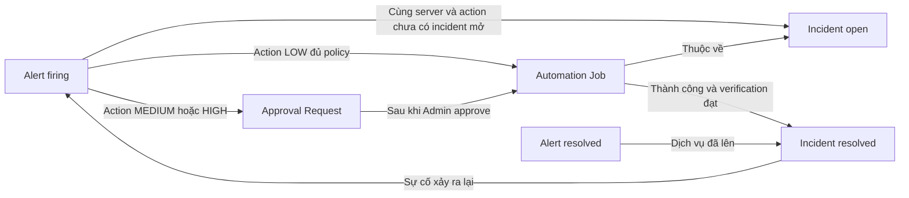
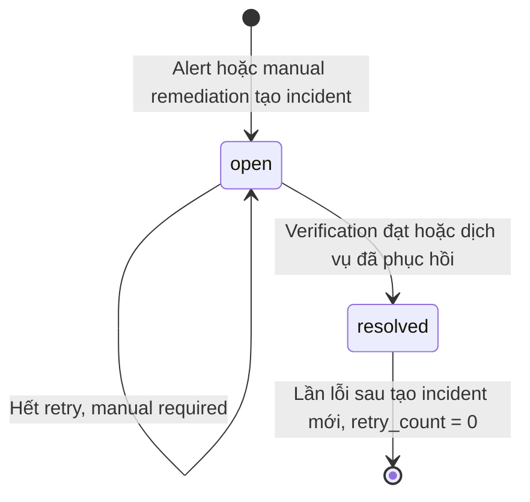
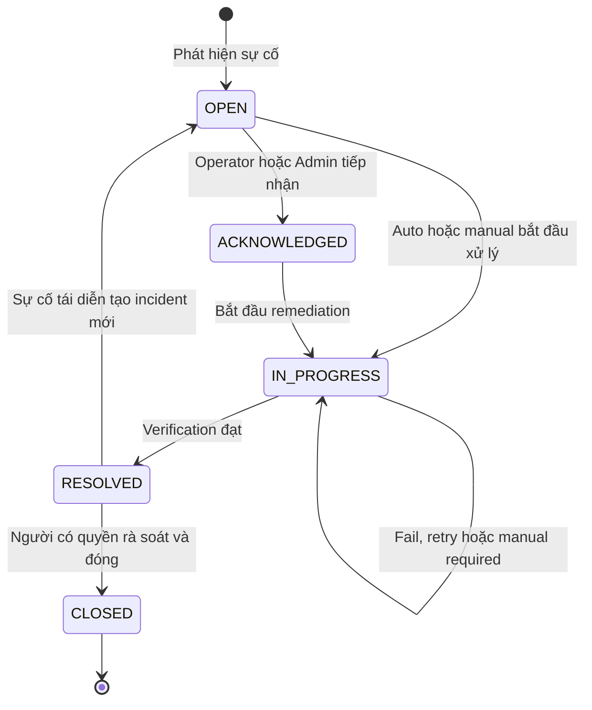

# DG-07 – Incident State Diagram

**Đề tài:** Xây dựng hệ thống giám sát và tự động hóa vận hành hạ tầng trong môi trường Hybrid Cloud  
**Phụ trách:** Nguyễn Thế Gia Bảo – Application / Integration  
**Baseline dữ liệu:** bảng `incidents`, đã có từ auto-remediation Tuần 6 và được job, approval dùng tiếp ở Tuần 8–9  
**Phạm vi Tuần 10:** vòng đời vận hành đầy đủ, màn hình incident và các trạng thái chưa có trong database

## 1. Mục đích

Sơ đồ tách hai lớp:

1. Trạng thái **đã lưu** trong SQLite: `open` và `resolved`, cùng các cờ mô tả kết quả xử lý.
2. Trạng thái **dự kiến hoàn thiện ở Tuần 10**: acknowledge, in progress và close như các bước vận hành riêng.

Không dùng sơ đồ Tuần 10 để khẳng định các trạng thái đó đã có trên Portal.

## 2. Quan hệ Alert, Incident và Job

Một incident gắn một server và một `action_key`. Nó có thể gắn một alert. Nó chứa nhiều job: lần chạy đầu, tối đa một lần auto-retry, và job manual phát sinh sau đó.

Request duyệt không phải job. Request pending, rejected hoặc expired không làm incident chuyển sang resolved và không tạo job.

Alert `resolved` và incident `resolved` là hai bản ghi. Portal chỉ đóng incident khi có bằng chứng phục hồi: job SUCCESS hoặc kiểm tra thấy dịch vụ đã trả lời. Một alert hết firing không tự bị xem là job thành công.

## 3. State Diagram đã triển khai

`open` không bị xóa khi xử lý thất bại. Các cờ trên cùng dòng cho biết vì sao incident vẫn mở:

| Cờ hoặc reason | Khi nào bật | Job final status | Ansible |
|---|---|---|---|
| `retry_count = 1`, reason `execution_failed` | Lệnh auto thất bại và còn một lần retry | `EXECUTION_FAILED` | Có, rồi chạy đúng một lần nữa |
| `manual_required`, reason `retry_limit` | Lần retry vẫn thất bại | `MANUAL_REQUIRED` | Không có lần thứ ba |
| `verification_failed`, `manual_required` | Lệnh chạy xong nhưng hậu kiểm thất bại | `VERIFICATION_FAILED` | Không retry |
| `blocked`, `manual_required`, reason `management_channel_unavailable` | SSH hoặc WinRM không dùng được | `BLOCKED` | Không gọi playbook |
| Job `canceled`, final `DUPLICATE_SKIPPED` | Đã có job cùng target và action đang queued hoặc running | `DUPLICATE_SKIPPED` | Không gọi playbook lần nữa |
| `status = resolved`, reason `success`, `closed_at` có giá trị | Hậu kiểm đạt | `SUCCESS` | Đã chạy và được xác nhận |

Manual job không tự retry. Nếu manual execution failed hoặc verification failed, incident ở lại `open` với cờ tương ứng để người vận hành quyết định bấm chạy job mới.

Cooldown 120 giây áp dụng cho auto sau SUCCESS. Cooldown không đổi `status`; nó chỉ chặn lần auto tiếp theo của cùng target và action.

## 4. Điều kiện chuyển trạng thái

| Từ | Sự kiện | Điều kiện | Sang | Việc ghi thêm |
|---|---|---|---|---|
| Chưa có incident mở | Alert firing có action allow-list, hoặc người dùng chạy manual | Không có incident `open` cùng server và action | `open` | Audit `incident.created`, `retry_count = 0` |
| `open` | Bắt đầu chạy | Pre-check đạt | `open` | Tạo job mới, không ghi đè job cũ |
| `open` | Execution failed | `retry_count` chưa tới 1 và mode là AUTO | `open` | Tăng `retry_count`, tạo job retry |
| `open` | Execution failed lần nữa | Đã dùng hết một lần retry | `open` | `manual_required = true`, reason `retry_limit` |
| `open` | Verification failed | Hậu kiểm không đạt | `open` | `verification_failed = true`, không retry |
| `open` | Management down | Probe SSH hoặc WinRM thất bại | `open` | `blocked = true`, playbook không chạy |
| `open` | Verification passed | Dịch vụ đúng cổng hoặc URL đã trả lời | `resolved` | `closed_at`, reason `success`, audit `incident.resolved` |
| `open` | Dịch vụ đã lên trước khi chạy | Probe thấy dịch vụ healthy | `resolved` | Không tạo job thực thi |
| `resolved` | Cùng dịch vụ down trở lại | `starts_at` của alert mới hơn lần đã xử lý | Incident mới `open` | Incident cũ giữ nguyên lịch sử |

Index `(server_id, action_key, status)` giúp tìm đúng incident đang mở. Sự cố tái diễn không reset incident đã resolved.

## 5. Ba kết quả người vận hành cần phân biệt

### Thành công

Job có execution thành công và verification đạt. `final_status` là `SUCCESS`. Incident chuyển `resolved`. Email remediation success đi theo nhóm Info. Auto của cùng action bước vào cooldown.

Với reboot, verification chưa được kết luận cho đến khi SSH cổng 22 và Nginx cùng lên. Playbook có thể đã trả điều khiển sau khi máy boot; Portal vẫn probe lại trước khi đóng incident.

### Thất bại có thể retry

Chỉ auto, chỉ khi lệnh thất bại trước hậu kiểm, và incident chưa dùng lần retry. Portal ghi `EXECUTION_FAILED`, gửi mail thất bại, rồi chạy một job mới trỏ `retry_of_job_id` về job vừa fail. Nếu kênh quản trị chết ở lần retry, kết quả là blocked và không chạy playbook.

### Cần can thiệp thủ công

Các trường hợp sau để incident mở và `manual_required = true`:

- Hết một lần retry.
- Verification failed.
- Không có action allow-list cho cảnh báo.
- Action không phải LOW nên auto chỉ mở approval request, không chạy.
- Management channel down.

Mail `manual_intervention.required` được ghi lại khi cửa sổ firing mới bắt đầu. Cùng một alert đang firing không gửi lặp cùng một nội dung. Người vận hành xử lý bằng manual remediation hoặc approval, không bằng cách sửa trạng thái incident trên một màn hình riêng.

## 6. State Diagram dự kiến Tuần 10

Các trạng thái `ACKNOWLEDGED`, `IN_PROGRESS` và `CLOSED` chưa có trong check constraint của bảng `incidents`. Tuần 10 cần, nếu vẫn giữ thiết kế này:

- quyết định các trạng thái nào trở thành giá trị `status`, các trạng thái nào vẫn là cờ;
- màn hình danh sách và chi tiết incident;
- audit khi người dùng acknowledge hoặc close;
- không cho phép close khi verification chưa đạt;
- giữ rule incident mới sau khi sự cố tái diễn.

Phần đã có và Tuần 10 nên tái sử dụng: liên kết alert, server, job, approval; retry một lần; không resolve khi dịch vụ chưa lên; không ghi đè job cũ.

## 7. Những gì chưa được coi là đã hoàn thành

- Chưa có menu Incident với bộ lọc và nút chuyển trạng thái.
- Chưa có assignee.
- Chưa lưu severity riêng trên incident.
- Chưa có trạng thái closed khác với resolved.
- Chưa có bằng chứng kiểm thử tuần 10 cho acknowledge và close.

Job Detail đã hiển thị Incident ID. Audit đã có `incident.created` và `incident.resolved`. Đó là phần truy vết đã triển khai, không phải màn hình quản lý vòng đời đầy đủ.

## 8. Tài liệu liên quan

- [SRS – FR-INC](../SRS.md)
- [SDD – Incident Management Design](../SDD.md)
- [DG-04 Database ERD](database-erd.md)
- [DG-05 Remediation Sequence](remediation-sequence.md)
- [DG-06 Approval Workflow](approval-workflow.md)
