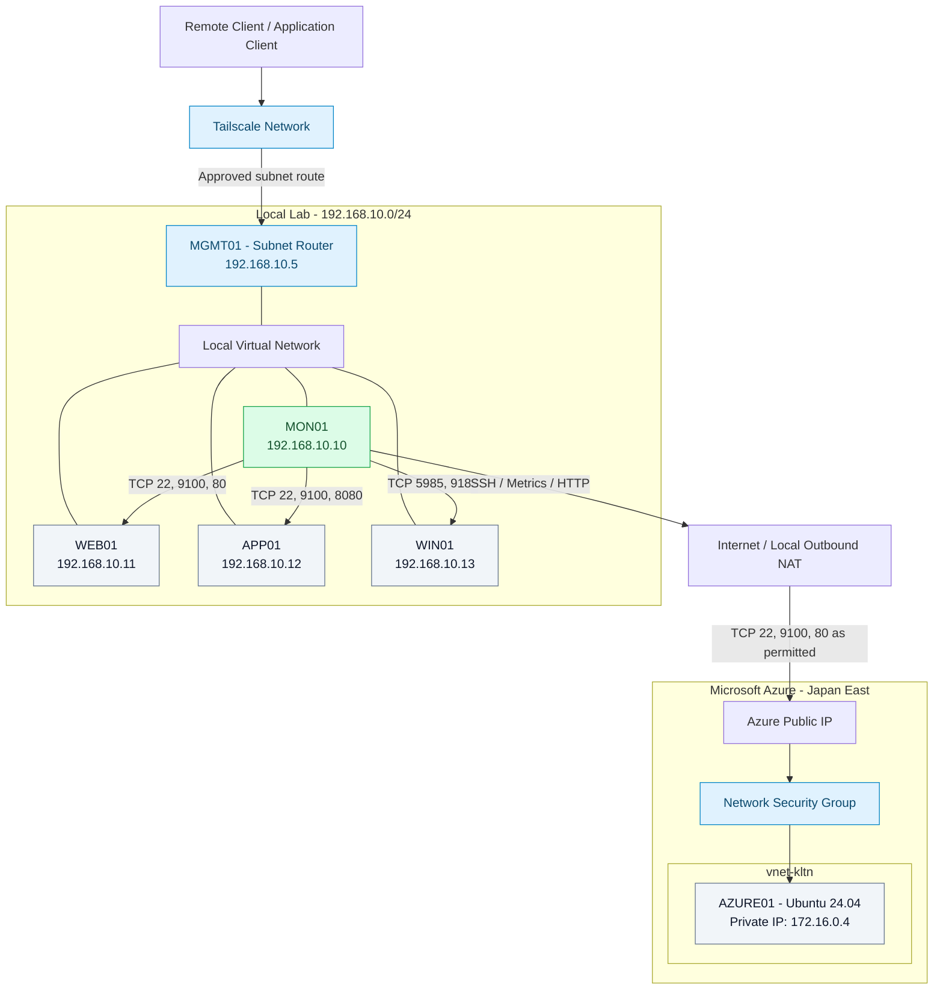

# DG-02 – Network Topology Diagram

**Đề tài:** Cloud Infrastructure Monitoring and Automation  
**Phụ trách:** Infrastructure / System / Cloud  
**Baseline:** Tuần 9 – Hybrid Cloud Lab

## 1. Mục đích

Sơ đồ mô tả phân vùng mạng, địa chỉ IP, đường truy cập từ xa, kết nối giám sát và quản trị giữa Local Infrastructure và Microsoft Azure. Đây là thiết kế mạng tương ứng với [DG-01 – System Architecture](system-architecture.md), không mở rộng phạm vi hạ tầng hiện tại.

## 2. Sơ đồ Network Topology

Đường nét thể hiện kết nối logic và luồng TCP cần thiết, không mô tả thứ tự thiết bị xử lý gói tin vật lý. Public IP và NSG là các thành phần mạng Azure liên quan đến luồng inbound; địa chỉ public cụ thể không được cố định trong tài liệu.

## 3. Network/IP Plan

| Máy chủ | Địa chỉ IP | Môi trường | Vai trò |
|---|---|---|---|
| MGMT01 | 192.168.10.5 | Local | Tailscale Subnet Router / Management Gateway |
| MON01 | 192.168.10.10 | Local | Monitoring và Ansible Control |
| WEB01 | 192.168.10.11 | Local | Nginx / Node Exporter |
| APP01 | 192.168.10.12 | Local | Docker / Node Exporter |
| WIN01 | 192.168.10.13 | Local | Windows Server 2022 / Windows Exporter / WinRM |
| AZURE01 | 172.16.0.4 (private) | Azure | Ubuntu Server 24.04 / Nginx / Node Exporter |

Local subnet: `192.168.10.0/24`. Azure Resource Group: `KLTN`; Region: `Japan East`; VNet: `vnet-kltn`. CIDR chính xác của Azure VNet/subnet và default gateway local cần đối chiếu cấu hình hiện hành; không suy ra từ IP máy chủ.

## 4. Port và luồng kết nối

| Nguồn | Đích | TCP port | Mục đích |
|---|---|---|---|
| MON01 | WEB01, APP01 | 22 | SSH / Ansible |
| MON01 | MON01, WEB01, APP01 | 9100 | Node Exporter metrics |
| MON01 | WIN01 | 5985 | WinRM HTTP / Ansible |
| MON01 | WIN01 | 9182 | Windows Exporter metrics |
| MON01 | WEB01 | 80 | Nginx service check |
| MON01 | APP01 | 8080 | Application service check |
| MON01 | AZURE01 qua Public IP | 22 | SSH / Ansible |
| MON01 | AZURE01 qua Public IP | 9100 | Node Exporter metrics |
| MON01 | AZURE01 | 80 | HTTP verification; phạm vi truy cập phụ thuộc cấu hình thực tế |
| Portal | MON01 | 9090 | Prometheus API |
| Client được phép | MON01 | 3000 | Grafana |
| Prometheus | Alertmanager trên MON01 | 9093 | Alert delivery |
| Alertmanager | Portal | Theo runtime Portal | Webhook `/api/alerts/webhook` |
| Remote client | MGMT01 / Tailscale | Theo cấu hình Tailscale | Truy cập subnet nội bộ |

Bảng mô tả các luồng nghiệp vụ, không phải danh sách firewall rule đã được kiểm chứng đầy đủ. Địa chỉ và port lắng nghe của Portal sẽ được xác nhận trong DG-08.

## 5. Remote Access Design

MGMT01 đảm nhiệm Tailscale Subnet Router. IP forwarding được bật và route `192.168.10.0/24` được advertise và approve trên Tailscale Admin Console. Client được cấp quyền có thể truy cập các máy local qua MGMT01.

Tách MGMT01 khỏi MON01 giúp duy trì đường truy cập quản trị khi MON01 gặp sự cố, miễn là MGMT01, mạng và kết nối Tailscale vẫn hoạt động. Thiết kế này không đồng nghĩa với High Availability cho dịch vụ monitoring.

## 6. Hybrid Cloud Connectivity

MON01 kết nối AZURE01 qua Internet và Azure Public IP. Không giả định có site-to-site VPN hoặc tuyến trực tiếp tới private IP `172.16.0.4`.

Theo báo cáo Tuần 7, NSG đã được bổ sung inbound TCP 9100 cho public outbound IP của mạng local để Prometheus scrape metrics. SSH sử dụng key riêng cho AZURE01 trong Ansible inventory. Nginx được kiểm tra qua HTTP trong remediation verification.

Phạm vi nguồn của rule SSH và HTTP cần đối chiếu NSG hiện hành. Không mở rộng rule chỉ để phù hợp sơ đồ. Public IP động hoặc thay đổi IP outbound có thể yêu cầu cập nhật inventory, scrape target hoặc NSG.

## 7. Security và giới hạn thiết kế

- Phân tách truy cập quản trị từ xa (MGMT01) và điều phối monitoring/automation (MON01).
- Sử dụng SSH key cho Linux; thông tin xác thực WIN01 được quản lý bằng Ansible Vault theo thiết kế hiện tại.
- Giới hạn nguồn truy cập exporter và management port theo nhu cầu thực tế; không công khai secret, private key hoặc credential trong repository.
- WinRM HTTP 5985 là cấu hình lab đã triển khai; cần đánh giá cơ chế xác thực, mã hóa và phạm vi mạng khi hardening.
- Khi management channel không khả dụng, remediation phải bị BLOCKED thay vì chạy playbook.
- Không bổ sung VPN Gateway, firewall appliance hoặc mạng HA ngoài phạm vi khóa luận.

## 8. Đối chiếu và kiểm tra

| Hạng mục | Phương pháp kiểm tra | Kết quả / trạng thái tài liệu |
|---|---|---|
| Local IP và route | `ip addr`, `ip route`, `ipconfig` | IP theo báo cáo Tuần 2–3 |
| Tailscale subnet access | `tailscale status`, truy cập IP local từ client được phép | Đã triển khai Tuần 3 |
| Prometheus targets | Prometheus Targets / truy vấn `up` | Local và AZURE01 đã tích hợp theo báo cáo |
| SSH Linux/Azure | `ansible AZURE01 -m ping` và kiểm tra target tương ứng | Azure ping thành công theo báo cáo Tuần 7 |
| WinRM | Kiểm tra port 5985 và Ansible win_ping với inventory hiện hành | WinRM đã triển khai Tuần 2 |
| Azure NSG | Đối chiếu inbound rules và source IP | TCP 9100 được giới hạn theo báo cáo Tuần 7; cần rà soát cấu hình hiện tại |

Các kết quả trên được tổng hợp từ báo cáo đã có, không phải kết quả kiểm thử mới.

## 9. Tài liệu liên quan

- [DG-01 – System Architecture](system-architecture.md)
- [SRS](../SRS.md)
- [SDD](../SDD.md)
- [Network Plan](https://github.com/Cucbong30/cloud-infrastructure-monitoring-automation/blob/main/infrastructure/docs/network-plan.md)
- [Port Plan](https://github.com/Cucbong30/cloud-infrastructure-monitoring-automation/blob/main/infrastructure/docs/ports.md)
- [Infrastructure Setup](https://github.com/Cucbong30/cloud-infrastructure-monitoring-automation/tree/main/infrastructure/docs/setup)
- [Week 07 – Hybrid Cloud](https://github.com/Cucbong30/cloud-infrastructure-monitoring-automation/tree/infra/infrastructure/docs/week07)
