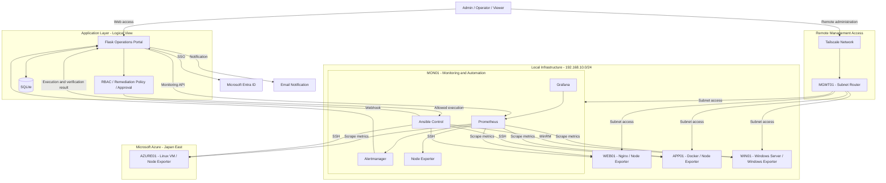

# DG-01 – System Architecture Diagram

> Đề tài: Thiết kế và xây dựng nền tảng giám sát và tự động hóa hạ tầng Cloud phục vụ vận hành hệ thống.
>
> Phạm vi: Kiến trúc đến Tuần 9; thiết kế Incident Management sẽ được hoàn thiện tại Tuần 10.

## 1. Mục đích

Sơ đồ mô tả kiến trúc tổng thể của hệ thống Hybrid Cloud, các thành phần giám sát, ứng dụng quản lý vận hành, tự động hóa, xác thực và kết nối quản trị. Các thành phần được phân chia theo chức năng để làm rõ trách nhiệm và luồng tương tác.

## 2. Sơ đồ kiến trúc tổng thể

**Lưu ý:** Application Layer là phân vùng chức năng logic, không khẳng định vị trí triển khai vật lý của Portal. Đường truy cập Portal và vị trí runtime sẽ được đối chiếu với cấu hình triển khai hiện tại trong DG-08. Các đường kết nối thể hiện luồng tương tác, không thay thế sơ đồ mạng DG-02.

## 3. Thành phần và vai trò

| Thành phần | Vai trò |
|---|---|
| MGMT01 | Management Gateway, cung cấp truy cập từ xa vào subnet nội bộ thông qua Tailscale. |
| MON01 | Máy chủ giám sát tập trung và điều phối Ansible. |
| WEB01 | Máy chủ Linux cung cấp dịch vụ Nginx. |
| APP01 | Máy chủ Linux vận hành Docker và workload thử nghiệm. |
| WIN01 | Máy chủ Windows Server, hỗ trợ monitoring và quản trị qua WinRM. |
| AZURE01 | Máy chủ Linux trên Microsoft Azure, đại diện cho môi trường Cloud. |
| Prometheus | Thu thập metrics và đánh giá alert rules. |
| Grafana | Trực quan hóa dữ liệu giám sát từ Prometheus. |
| Alertmanager | Chuyển cảnh báo đến Portal qua webhook. |
| Flask Operations Portal | Cung cấp giao diện vận hành, quản lý cảnh báo, job, quyền và phê duyệt. |
| SQLite | Lưu dữ liệu nghiệp vụ, lịch sử job và audit log. |
| Ansible | Thực hiện playbook được cho phép trên các máy chủ đích. |
| Microsoft Entra ID | Xác thực người dùng thông qua SSO. |
| Email Notification | Gửi thông báo theo sự kiện vận hành. |

## 4. Luồng hoạt động

### 4.1. Monitoring và Alerting

Prometheus thu thập metrics từ các exporter trên máy chủ nội bộ và Azure. Grafana truy vấn Prometheus để hiển thị dashboard. Khi điều kiện alert rule được đáp ứng, Prometheus gửi cảnh báo đến Alertmanager; Alertmanager chuyển sự kiện đến Portal. Portal cập nhật dữ liệu cảnh báo và cung cấp thông tin cho người vận hành.

### 4.2. Automation và Remediation

Portal tiếp nhận cảnh báo hoặc yêu cầu chạy thủ công, kiểm tra quyền, allow-list, chính sách và mức độ rủi ro trước khi điều phối Ansible. Action LOW có thể chạy trực tiếp nếu đáp ứng điều kiện; MEDIUM và HIGH cần Admin phê duyệt. Khi bị từ chối hoặc hết hạn phê duyệt, action không được thực thi.

Ansible kết nối máy chủ Linux qua SSH và Windows qua WinRM. Quy trình remediation có pre-check và verification; cơ chế tự động áp dụng retry, cooldown và chống job trùng theo policy. SUCCESS chỉ được ghi nhận khi verification thành công. Portal lưu kết quả job, audit log và gửi thông báo phù hợp.

### 4.3. Identity và Access Control

Microsoft Entra ID cung cấp SSO; Portal kiểm soát quyền nghiệp vụ bằng RBAC với ba vai trò Admin, Operator và Viewer. Quyền truy cập mạng qua Tailscale không thay thế quyền thực hiện action trong Portal.

## 5. Quyết định thiết kế và giới hạn

- Tách MGMT01 khỏi MON01 nhằm duy trì đường quản trị từ xa khi MON01 gặp sự cố, với điều kiện MGMT01 và mạng vẫn khả dụng.
- Sử dụng MON01 làm điểm điều phối tập trung, tránh cài thêm Ansible Control trên từng target.
- Sử dụng Flask và SQLite phù hợp phạm vi lab, không triển khai thêm microservices hoặc database cluster.
- Giới hạn automation theo allow-list, RBAC và approval policy; không cho phép chạy lệnh tùy ý từ Portal.
- MON01 vẫn là điểm phụ thuộc tập trung của monitoring và automation; kiến trúc hiện tại không cam kết High Availability.
- Incident lifecycle hoàn chỉnh thuộc phạm vi Tuần 10; không thể hiện các chức năng chưa hoàn thành như kết quả đã triển khai.

## 6. Tài liệu liên quan

- [SRS](../SRS.md)
- [SDD](../SDD.md)
- [Network Plan](https://github.com/Cucbong30/cloud-infrastructure-monitoring-automation/blob/main/infrastructure/docs/network-plan.md)
- [VM Specification](https://github.com/Cucbong30/cloud-infrastructure-monitoring-automation/blob/main/infrastructure/docs/vm-specification.md)
- [Port Plan](https://github.com/Cucbong30/cloud-infrastructure-monitoring-automation/blob/main/infrastructure/docs/ports.md)
- [Action Risk Matrix - Week 09](https://github.com/Cucbong30/cloud-infrastructure-monitoring-automation/blob/infra/infrastructure/docs/week09/configs/action-risk-matrix.md)
- [Approval Policy - Week 09](https://github.com/Cucbong30/cloud-infrastructure-monitoring-automation/blob/infra/infrastructure/docs/week09/configs/approval-policy.md)
