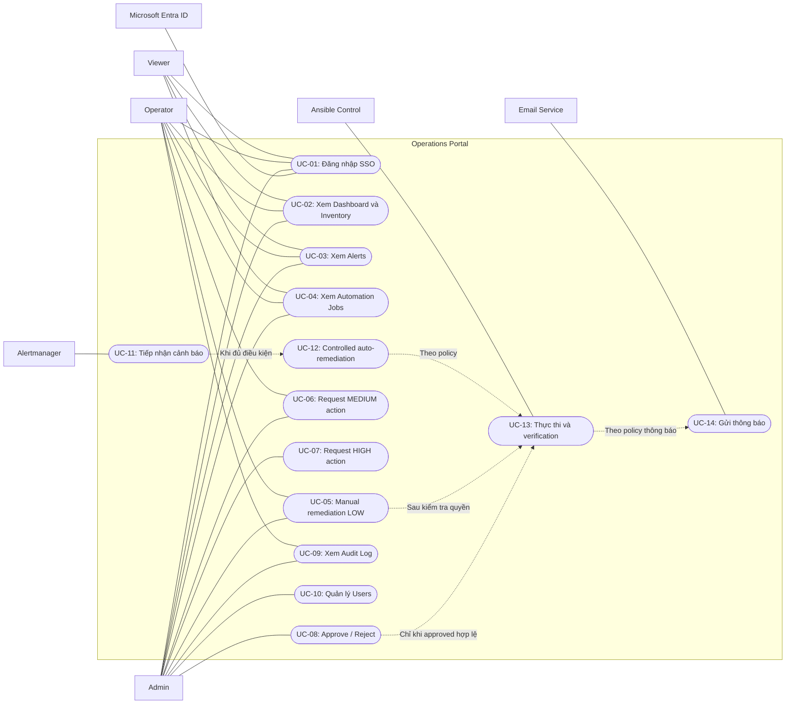

# DG-03 – Use Case Diagram

**Đề tài:** Thiết kế và xây dựng nền tảng giám sát và tự động hóa hạ tầng Cloud phục vụ vận hành hệ thống  
**Phụ trách:** Nguyễn Thế Gia Bảo – Application / Integration  
**Baseline:** Tuần 9; phần mở rộng Incident Management thuộc Tuần 10.

## 1. Mục đích

Sơ đồ mô tả các chức năng của Operations Portal theo từng actor, phân biệt quyền xem thông tin, thực hiện remediation và phê duyệt action. Quyền được kiểm tra ở backend, không chỉ thông qua việc ẩn nút trên giao diện.

## 2. Use Case Diagram

Mermaid chưa có cú pháp UML Use Case chuyên biệt; sơ đồ dưới đây sử dụng flowchart với actor bên ngoài và use case dạng bo tròn trong ranh giới hệ thống.

Đường liền biểu thị actor tham gia use case; đường nét đứt biểu thị luồng nghiệp vụ có điều kiện, không phải quan hệ UML include/extend bắt buộc. MEDIUM/HIGH request chưa đồng nghĩa với thực thi.

## 3. Actor và phạm vi quyền

| Actor | Vai trò |
|---|---|
| Viewer | Theo dõi thông tin giám sát và lịch sử job; không thực thi remediation. |
| Operator | Theo dõi, thực hiện LOW action, gửi yêu cầu MEDIUM và xem Audit Log. |
| Admin | Quản trị người dùng, thực hiện LOW, yêu cầu MEDIUM/HIGH, quyết định approval và xem Audit Log. |
| Microsoft Entra ID | Cung cấp xác thực SSO. |
| Alertmanager | Gửi cảnh báo đến Portal. |
| Ansible Control | Thực thi action được Portal cho phép và trả kết quả. |
| Email Service | Chuyển thông báo theo chính sách. |

## 4. Ma trận phân quyền

| Chức năng | Admin | Operator | Viewer |
|---|---|---|---|
| Đăng nhập SSO | Có | Có | Có |
| Xem Dashboard / Inventory | Có | Có | Có |
| Xem Alerts / Jobs | Có | Có | Có |
| Manual LOW | Có | Có | Không |
| Request MEDIUM | Có | Có | Không |
| Request HIGH | Có | Không | Không |
| Approve / Reject | Có | Không | Không |
| Xem Audit Log | Có | Có | Không |
| Quản lý Users | Có* | Không | Không |

\* Báo cáo Tuần 8 xác nhận menu Users xuất hiện với Admin; phạm vi CRUD cụ thể cần đối chiếu source hiện hành. Các quyền đọc Dashboard, Inventory và Alerts là phạm vi thiết kế, cần đối chiếu đầy đủ route nếu dùng làm kết quả nghiệm thu.

## 5. Đặc tả các use case chính

| ID | Use case | Điều kiện / kết quả mong đợi |
|---|---|---|
| UC-01 | SSO | Xác thực qua Entra ID; Portal kiểm tra role khi truy cập chức năng. |
| UC-02–04 | Monitoring và tra cứu | Hiển thị trạng thái server, cảnh báo và kết quả job; không làm thay đổi trạng thái target. |
| UC-05 | Manual LOW | Admin/Operator có quyền; action hợp lệ và qua các kiểm tra an toàn trước khi thực thi. Không tự retry job manual. |
| UC-06 | MEDIUM request | Admin/Operator gửi yêu cầu; chỉ thực thi sau khi Admin phê duyệt hợp lệ. Ví dụ restart Docker Service. |
| UC-07 | HIGH request | Chỉ Admin gửi yêu cầu; vẫn cần approval hợp lệ. Ví dụ reboot AZURE01. |
| UC-08 | Approval decision | Admin approve hoặc reject; request hết hạn sau 5 phút không được tạo execution job. |
| UC-09 | Audit | Admin/Operator xem lịch sử; AUTO ghi SYSTEM, MANUAL ghi người thực hiện. |
| UC-10 | Users | Admin truy cập chức năng quản lý người dùng; phạm vi thao tác theo source thực tế. |
| UC-11 | Alert ingestion | Nhận webhook, ghi nhận và cập nhật cảnh báo theo cơ chế chống trùng. |
| UC-12 | Controlled auto-remediation | Kiểm tra allow-list, cooldown 120 giây, duplicate và management channel; retry tối đa một lần chỉ khi execution failed theo policy. |
| UC-13 | Execution & verification | Chạy playbook hợp lệ; chỉ SUCCESS khi verification thành công. Management blocked không chạy playbook. |
| UC-14 | Notification | Gửi email theo loại sự kiện và severity đã cấu hình. |

## 6. Business Rules

- Viewer không được trigger manual remediation; backend từ chối bằng HTTP 403.
- Operator không được request HIGH hoặc quyết định approval.
- LOW được thực thi trực tiếp sau khi thỏa điều kiện quyền và policy; MEDIUM/HIGH phải qua approval.
- Request rejected hoặc expired không kích hoạt Ansible.
- Không chạy job trùng khi cùng target và action đang queued hoặc running.
- Verification Failed không sử dụng ngân sách retry của Execution Failed.
- Credential quản trị target thuộc Ansible inventory/control node; Portal không truyền private key của AZURE01.
- Không suy diễn yêu cầu tách người request và người approve; quy tắc này cần đối chiếu nếu muốn bổ sung.

## 7. Phạm vi Tuần 10

Incident đã xuất hiện trong dữ liệu và kết quả remediation của Tuần 8–9. Các use case quản lý vòng đời Incident như acknowledge, chuyển trạng thái và close sẽ được đặc tả riêng trong DG-07 và hoàn thiện theo kế hoạch Tuần 10. Không đánh dấu các chức năng đó là đã nghiệm thu trong baseline này.

## 8. Tài liệu đối chiếu

- [DG-01 – System Architecture](system-architecture.md)
- [DG-02 – Network Topology](network-topology.md)
- [DG-04 – Database ERD](database-erd.md)
- [DG-06 – Approval Workflow](approval-workflow.md)
- [DG-07 – Incident State Diagram](incident-state-diagram.md)
- [SRS](../SRS.md) và [SDD](../SDD.md)
- [Application – Tuần 8, RBAC và manual remediation](https://github.com/Cucbong30/cloud-infrastructure-monitoring-automation/commit/4960f041ed12294b595016e993720ba209fd6bf8)
- [Application – Tuần 9, Approval Service](https://github.com/Cucbong30/cloud-infrastructure-monitoring-automation/blob/b95ad447b07e58401e4296b4bd67a15852064998/application/app/services/approval.py)
- [Application – Tuần 9, Approval Test](https://github.com/Cucbong30/cloud-infrastructure-monitoring-automation/blob/b95ad447b07e58401e4296b4bd67a15852064998/application/tests/test_week9.py)
- [Infrastructure – Risk Matrix](https://github.com/Cucbong30/cloud-infrastructure-monitoring-automation/blob/infra/infrastructure/docs/week09/configs/action-risk-matrix.md)

**Trạng thái:** Bản thiết kế đối chiếu báo cáo Tuần 8–9. Cần review source/route và preview Mermaid trên GitHub trước khi chốt hồ sơ nộp. ID use case là mã tài liệu DG-03, cần đồng bộ với SRS/RTM khi rà soát cuối.
