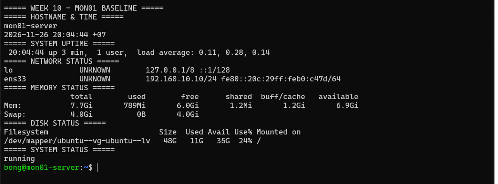
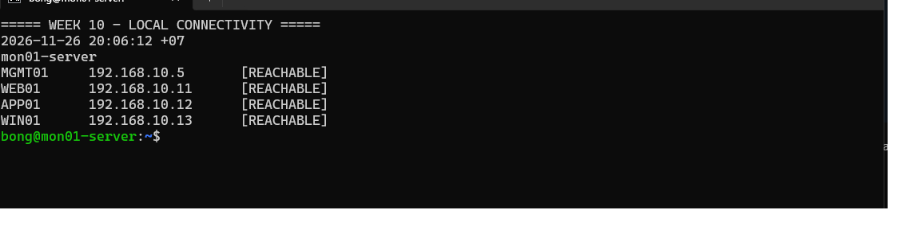
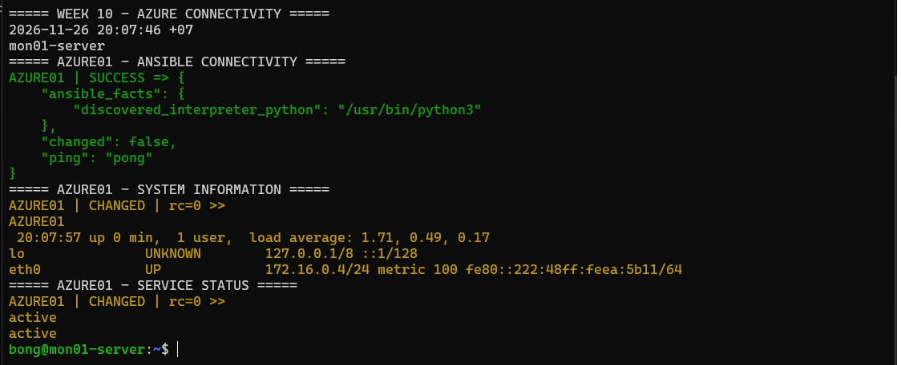
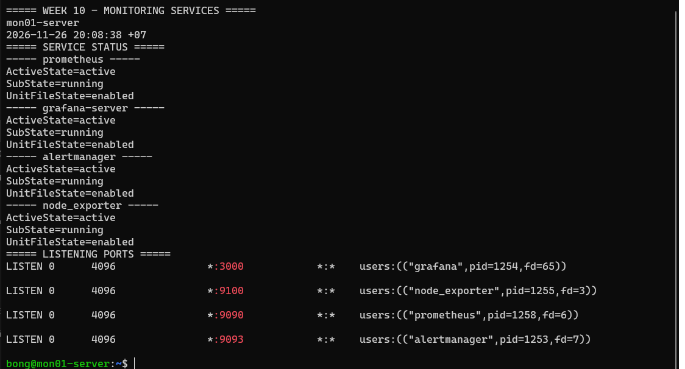
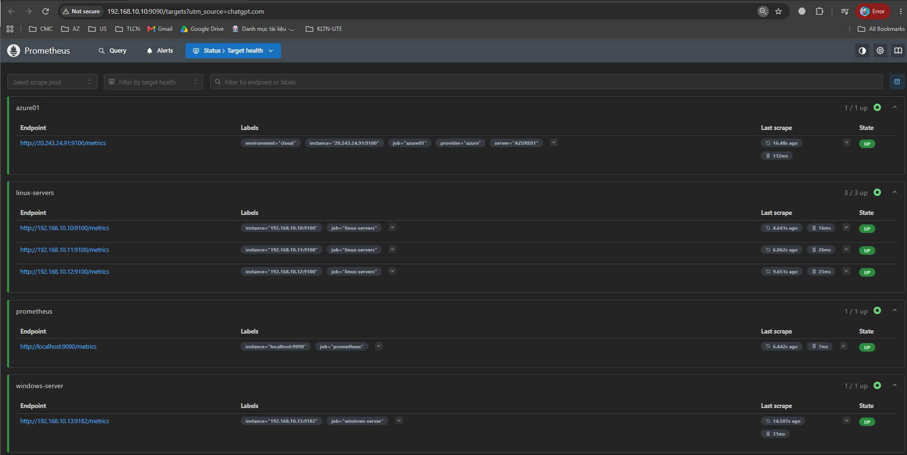
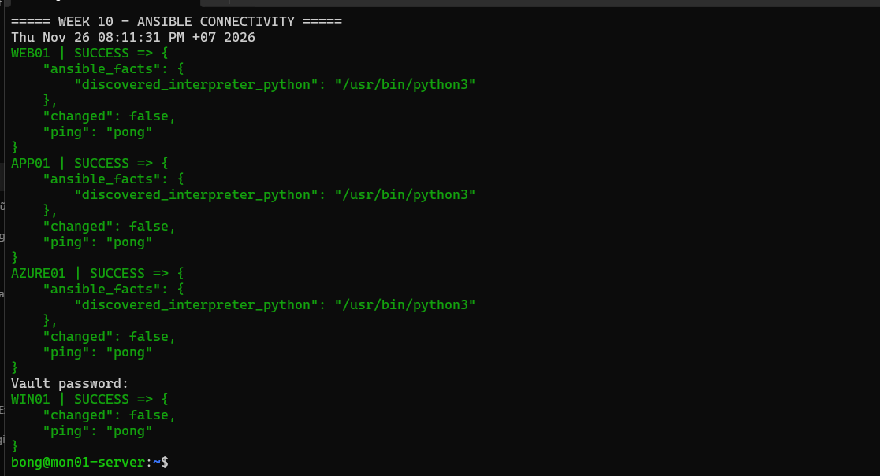

# Week 10 – Infrastructure Baseline Check

## 1. Mục đích

Kiểm tra trạng thái hạ tầng hiện tại trước khi tích hợp Incident Management Workflow.

Đảm bảo các máy chủ, dịch vụ Monitoring và kênh quản trị Ansible hoạt động bình thường, sẵn sàng cho quá trình kiểm thử với Application.

## 2. Kiểm tra MON01

Kiểm tra hostname, địa chỉ IP, uptime, RAM, dung lượng ổ đĩa và trạng thái hệ thống.

- Target: MON01
- IP Address: 192.168.10.10
- Result: PASS

## 3. Kiểm tra Local Connectivity

Kiểm tra kết nối từ MON01 đến các máy chủ trong Local Lab.

| Target | IP Address | Result |
|---|---|---|
| MGMT01 | 192.168.10.5 | PASS |
| WEB01 | 192.168.10.11 | PASS |
| APP01 | 192.168.10.12 | PASS |
| WIN01 | 192.168.10.13 | PASS |

## 4. Kiểm tra Azure Connectivity

Kiểm tra khả năng kết nối và quản trị AZURE01 thông qua Ansible từ MON01.

| Thành phần | Thông tin |
|---|---|
| Target | AZURE01 |
| Cloud Provider | Microsoft Azure |
| Region | Japan East |
| Private IP | 172.16.0.4 |
| Management Protocol | SSH |
| Result | PASS |

## 5. Kiểm tra Monitoring Services

Kiểm tra trạng thái các dịch vụ Monitoring và Alerting trên MON01.

| Service | Port | Result |
|---|---|---|
| Prometheus | 9090 | PASS |
| Grafana | 3000 | PASS |
| Alertmanager | 9093 | PASS |
| Node Exporter | 9100 | PASS |

## 6. Kiểm tra Prometheus Targets

Kiểm tra khả năng thu thập metrics từ môi trường Local và Azure.

| Target | Port | Status |
|---|---|---|
| MON01 | 9100 | UP |
| WEB01 | 9100 | UP |
| APP01 | 9100 | UP |
| WIN01 | 9182 | UP |
| AZURE01 | 9100 | UP |
| Prometheus | 9090 | UP |

Kết quả:

- Total Targets: 6
- UP: 6
- DOWN: 0
- Result: PASS

## 7. Kiểm tra Alert Rules

Kiểm tra Alert Rule đang được Prometheus sử dụng để phát hiện sự cố.

| Thuộc tính | Giá trị |
|---|---|
| Alert Name | InstanceDown |
| Expression | up == 0 |
| Severity | critical |
| Result | PASS |

Rule InstanceDown phát hiện các target không thể scrape metrics.

Các sự cố ở cấp độ dịch vụ như Nginx hoặc Docker cần được đối chiếu với cơ chế Service Probe phía Application.

## 8. Kiểm tra Ansible Connectivity

Kiểm tra khả năng quản trị các máy chủ Linux và Windows thông qua Ansible.

| Target | Connection | Module | Result |
|---|---|---|---|
| WEB01 | SSH | ping | PASS |
| APP01 | SSH | ping | PASS |
| WIN01 | WinRM | win_ping | PASS |
| AZURE01 | SSH | ping | PASS |

WIN01 tiếp tục sử dụng credential được bảo vệ bằng Ansible Vault.

Không thay đổi Inventory, Credential hoặc Production Playbook trong quá trình kiểm tra.

## 9. Tổng hợp kết quả

| Hạng mục | Kết quả |
|---|---|
| MON01 System Baseline | PASS |
| Local Connectivity | PASS |
| Azure Connectivity | PASS |
| Monitoring Services | PASS |
| Prometheus Targets | PASS |
| Alert Rules | PASS |
| Ansible Connectivity | PASS |

## 10. Kết luận

Infrastructure Baseline đã được kiểm tra thành công vào ngày 26/11/2026.

Hệ thống Monitoring, Alerting và Ansible hiện tại sẵn sàng phục vụ quá trình tích hợp Incident Management Workflow.

Các thành phần đã triển khai từ những tuần trước được giữ nguyên và tái sử dụng.

**Final Result: PASS**
